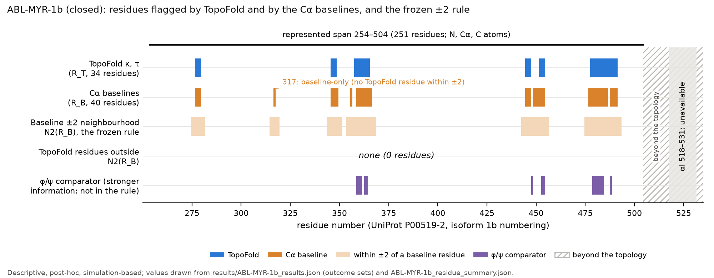

# Figure: ABL-MYR-1b residue-level coverage (supplement, 2026-10-25)

**Purpose.** To show, residue by residue, how the closed ABL-MYR-1b comparison reached its outcome, so a reader can see the
frozen ±2-residue rule at work instead of reading lists of numbers.

**What it shows.** Rows, top to bottom: the residues flagged by TopoFold (κ, τ; 34 residues); the residues flagged by the
equal-information Cα baselines (d(i,i+2), d(i,i+3), RMSF; 40 residues); the ±2-residue neighbourhood of the baseline
residues, which is the frozen rule; the TopoFold residues that fall outside that neighbourhood; and the φ/ψ comparator
(stronger information, reported separately, not part of the rule; 15 residues). **No TopoFold-only residue survived the
specified rule** (0 of 34 residues outside the baseline ±2 neighbourhood). One residue, 317, is flagged by a baseline
with no TopoFold residue within ±2. The represented span is residues 254–504; the αI helix (518–531) is not in the
topology, and no statement is made about it or about the myristoyl pocket.

**Main limitation.** The evidence is descriptive, post-hoc and simulation-based: one published set of simulations of one
kinase-domain model, two thermostat sets that are a consistency check and not independent replication, frames 2 ns apart,
no p-value or calibrated test. The result says that, for this dataset and this frozen rule, the κ/τ signal adds no residue
that the Cα baselines do not already flag. It is not evidence about other systems, about biology, or about Ayaz WT/M472I or
HDX.

**Evidence class.** Measured results: the plotted residue sets, recorded by the frozen wrapper. Schematic elements: the
shaded ±2 band (drawn from the recorded baseline set by the frozen definition) and the span and region marks.

**Source data.** `results/ABL-MYR-1b_results.json` (outcome sets as topology indices and the index-to-residue map) and
`results/ABL-MYR-1b_residue_summary.json` (residue numbers, isoform 1b numbering). SHA-256 of both inputs, of the generator
and of the PNG are in `ABL-MYR-1b_residue_coverage_SUPPLEMENT_2026-10-25_provenance.json`.

**Reproduce.** `PYTHONPATH=python .venv/bin/python benchmarks/audit/abl_myr_1b/plot_residue_coverage_supplement.py`
(about 1.5 CPU-seconds; matplotlib only). The generator stops if the two inputs disagree or if the ±2 rule applied to the
recorded sets does not reproduce the recorded outside sets. It writes only the files in this directory.

**Storage note.** The hashes and the copy of the archives in `~/Downloads` are not an independent backup (same device);
the backup gap recorded in `../CLOSEOUT_2026-10-25.md` is unchanged. No data were uploaded anywhere.
