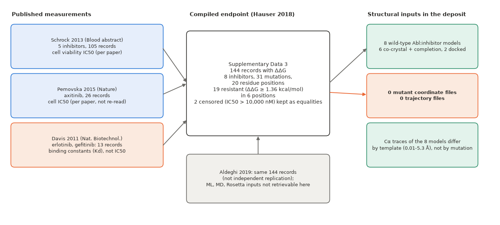

# Correction addendum to the Abl response intake (dated 2026-10-27)

Generated by `make_corrections.py` from `results/endpoint_cohort_2026-10-27.json` and the earlier inspection. The original `REPORT.md`, `results/abl_response_intake_record.json` and decision-log entry D89 are preserved unchanged; the statements corrected below are superseded by this addendum (D90). **No model was trained or scored; nothing was sent externally.** Evidence scope: assay-record structure and feasibility only.

## Corrections

**C1.** Original: 144 variant-drug ΔΔG records presented as one endpoint with a binding-free-energy reading in places.
Corrected: Three separate cohorts by assay and source: 105 Ba/F3 cell-viability IC50 records for five inhibitors (Schrock 2013), 26 axitinib IC50 records (Pemovska 2015; assay not verified), 13 erlotinib/gefitinib binding-constant records (Davis 2011; phosphorylated Abl; constructs not verified). Their transformed values are not pooled. Even within the cell-viability cohort ΔΔG is a log-potency shift expressed in kcal/mol at 300 K under the authors' assumptions, not a binding free energy.

**C2.** Original: wild-type IC50 'implied' from the sheet; 'the sheet gives no wild-type IC50'.
Corrected: Two different things are separated. (i) Reproducing the published transformation: the official SI states the wild-type IC50 for six inhibitors (axitinib 823, bosutinib 71, dasatinib 2, imatinib 201, nilotinib 15, ponatinib 3 nM) and these agree with the values implied by the sheet (e.g. 71 vs 70.96 nM); SI and GitHub sheet agree on 131/131 IC50 values and 144/144 ΔΔG values. For erlotinib and gefitinib the denominators (inferred 75.9 and 480.3 nM) equal the phosphorylated-Abl wild-type values in the Hauser reproduction of the Davis data (76 and 480 nM), not the Davis paper itself. (ii) Independently verifying the original wild-type and mutant measurements: not done; only the abstract's stated ranges and the compilations were seen.

**C3.** Original: ponatinib G250E recorded as an unresolved discrepancy within the sheet.
Corrected: The same IC50 (0.021 nM) and ΔΔG (0.3 kcal/mol) appear in the official SI, and 0.021 nM lies outside the ponatinib range 3-16 nM stated in the Schrock abstract, while 0.3 kcal/mol corresponds to about 5.0 nM given the wild-type value 3 nM. The record is excluded from the primary cohort; its origin remains unresolved.

**C4.** Original: 'Only a large improvement could be detected' from a site-level AUROC standard error of 0.12 at a true AUROC of 0.8.
Corrected: Withdrawn. The calculation assumed a true AUROC of 0.8, a binary label per position and independent positions; none of these was the proposed prediction unit, endpoint or metric, so it does not establish what improvement is detectable, and no sample-count threshold is treated as evidence of adequate power.

**C5.** Original: 'Internal analysis: conditional'.
Corrected: Replaced by: unresolved. No source notice read states reuse terms for the data files; see the notice table. No legal conclusion is drawn and no permission is assumed.

**C6.** Original: two censored values; five inhibitors trace to a conference abstract that was not read.
Corrected: The abstract was read (Crossref metadata): assay 'engineered Ba/F3 cells, cell viability at 72 hours', 21 single mutants, five inhibitors, IC50 ranges that match the sheet (table below), and T315I reported only as '>4000' for the non-ponatinib inhibitors while the compilation gives numbers (bosutinib 4338, dasatinib 10000, imatinib 9773, nilotinib 8091). These four, plus imatinib L248R stored at 10,000 nM, are flagged as censored or bound-like and are treated in a sensitivity subset; whether the numbers are exact values or ceilings is unresolved.

*Figure 1 (unchanged from the intake; reading corrected by this addendum). Purpose: trace records to sources. Read the three left boxes as three separate cohorts (cell viability, axitinib cell IC50 of unverified assay type, binding constants), and the central box as a compilation, not one homogeneous endpoint; the Cα-trace statement on the right is unchanged. Limitation: assay and source attributions for the axitinib and binding cohorts are unverified.*

## Cohorts and the proposed primary cohort

| cohort | records | substitutions | positions | drugs | source groups | resistant records (ΔΔG ≥ 1.36) | positions with a resistant record |
|---|---|---|---|---|---|---|---|
| primary_candidate_bafs_viability | 105 | 21 | 13 | 5 | 1 | 18 | 6 |
| secondary_axitinib_cell_ic50 | 26 | 26 | 18 | 1 | 1 | 0 | 0 |
| secondary_binding_davis_kd | 13 | 7 | 6 | 2 | 1 | 1 | 1 |
| primary candidate after exclusion | 104 | 21 | 13 | 5 | 1 | 18 | 6 |
| primary sensitivity subset (flagged removed) | 99 | 21 | 13 | 5 | 1 | 13 | 6 |

*Table 1. Purpose: count the meaningful units per cohort after exclusions. Source: `results/endpoint_cohort_2026-10-27.json`. Limitation: counts say nothing about adequacy.*

**Proposed primary cohort:** the Ba/F3 cell-viability (72 h) IC50 records of the five Schrock inhibitors (bosutinib, dasatinib, imatinib, nilotinib, ponatinib; templates 3UE4, 4XEY, 1OPJ, 3CS9, 3OXZ): 104 records, 21 substitutions at 13 positions, 1 source group, after excluding ponatinib G250E. Per-record source, assay, wild-type reference, units, censoring flags and discrepancies are in the `records` list of the JSON. The axitinib and binding cohorts stay separate and are not analysed with it.

| inhibitor | IC50 range stated in the abstract (nM, excluding T315I) | sheet min-max excluding T315I (nM) | wild-type IC50 in SI (nM) | wild-type implied by sheet (nM) |
|---|---|---|---|---|
| bosutinib | [40, 1280] | [40.0, 1280.0] | 71.0 | 70.96 |
| dasatinib | [2, 104] | [2.0, 104.0] | 2.0 | 2.0 |
| imatinib | [201, 10000] | [266.0, 10000.0] | 201.0 | 200.91 |
| nilotinib | [12, 784] | [12.0, 784.0] | 15.0 | 14.99 |
| ponatinib | [3, 16] | [0.021, 16.0] | 3.0 | 3.01 |

*Table 2. The sheet agrees with the abstract's ranges, except ponatinib (the G250E value 0.021 nM) and the imatinib lower end, which the abstract's 201 matches to the wild-type value, not a mutant.*

Records with unresolved flags:

| record | flags |
|---|---|
| bosutinib:T315I | abstract_reports_only_'>4000'; numeric value comes from the compilation |
| dasatinib:T315I | abstract_reports_only_'>4000'; numeric value comes from the compilation, at_10000_nM_assay_ceiling_stored_as_equality |
| imatinib:L248R | at_10000_nM_assay_ceiling_stored_as_equality |
| imatinib:T315I | abstract_reports_only_'>4000'; numeric value comes from the compilation |
| nilotinib:T315I | abstract_reports_only_'>4000'; numeric value comes from the compilation |
| ponatinib:G250E | ic50_outside_range_stated_in_source_abstract, ddg_in_sheet_disagrees_with_ic50_and_wt |

## Is an exploratory position-grouped comparison interpretable?

Only as a pilot. The 104 records form 13 position groups (records per position: 244: 5, 248: 10, 250: 4, 253: 5, 255: 10, 299: 5, 315: 10, 317: 20, 351: 5, 355: 5, 359: 15, 396: 5, 459: 5); the largest group (317, 20 records) holds 19% of the records, and 6 positions carry all 18 resistant records (13 in the sensitivity subset). Records of one position share the residue and its template context across drugs, so they are strongly dependent; there is one assay, one laboratory, and the drug is perfectly confounded with its template. An exploratory result could show a gross failure (no consistent direction across positions) or a consistent direction that deserves confirmation; it could not support a statement of improvement, equivalence or generalization beyond this assay. No sample-count threshold is used as evidence of power.

## Terms: what the notices establish

| source | notice read | establishes | does not establish |
|---|---|---|---|
| Hauser et al. 2018 article | 'Open Access This article is licensed under a Creative Commons Attribution 4.0 International License ... The images or other third party material in this article are included in the article's Creative Commons license, unless indicated otherwise in a credit line to the material.' | CC BY 4.0 for the article and its included material | terms for the GitHub files, the supplementary PDF or the third-party source values |
| Hauser Data availability statement | 'All relevant data are publicly available: compiled experimental datasets, input files for Prime and FEP+, and computational results that support our findings can be found at GitHub ...' | the authors made these files publicly available | any licence or reuse terms |
| GitHub repository kehauser/Predicting-resistance-... (commit d5c6c508) | licence field null in the API; no licence file in the 6-file tree; README: 'houses supplementary data files associated with the publication' | public availability | reuse, redistribution or commercial terms |
| Official supplementary PDF (Springer ESM MOESM1) | text searched for licence, copyright, creative, permission, reuse: no match | no notice in the file | its terms (the article's licence statement does not mention it) |
| Schrock et al. 2013 abstract (Crossref metadata) | no licence element in the Crossref record; the publisher page returned a challenge page to a non-browser client | a metadata abstract was read | terms |
| Pemovska et al. 2015 and Davis et al. 2011 | not accessed (publisher supplementary URLs returned HTTP 403; articles not open access per Europe PMC) | nothing | assay details, tables or terms |

The notices establish public availability and CC BY 4.0 for the article text. They do not state reuse terms for the data files. No legal conclusion is drawn; no permission is assumed. Statuses: internal evaluation, publication of derived results (data files), redistribution and commercial use are all recorded as **unresolved**.

## Decision on implementation

**The data-dependent feature export is not run.** Missing evidence, named exactly: a statement of reuse terms for the GitHub files, the supplementary PDF and the third-party values (owner decision; no one was contacted); the Schrock figure data (per-record Ba/F3 IC50 and the wild-type measurement) from the full source; the origin of the ponatinib G250E value; whether the T315I values are exact IC50 values or ceilings; the Pemovska and Davis tables for the secondary cohorts. No builder was written: the feature definitions should be fixed after the terms and cohort decisions, and a builder tested only on synthetic data would commit to a design before those decisions. The unfrozen evaluation proposal is in `EVALUATION_PROPOSAL_UNFROZEN_2026-10-27.md`.

Downloads in this correction: 187 kB (official supplementary PDF and the Crossref record of the abstract; ceiling 20 MB); cumulative 17.4 MB. Publisher pages that returned HTTP 403 or a challenge page were not circumvented; the 832 MB Zenodo archive was not downloaded.
