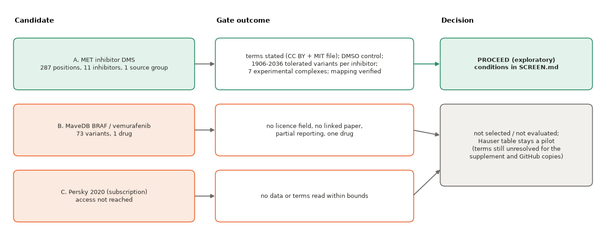

# Candidate screen for a variant-drug response test of structural site context (generated, 2026-10-27)

Generated by `make_screen_report.py` from `results/*.json`. Task: one bounded screen of at most three alternatives plus the narrow Hauser permissions check. **No model was trained or scored; nobody was contacted.** Downloads: 16.2 MB of 20 MB (structure files, two DMS tables, article XML, publisher and policy pages). Different tasks are not substituted for each other: all three candidates have a drug-exposure endpoint; functional scans without drug exposure were not considered.

## Decision: **Proceed (exploratory) with candidate A, the MET kinase inhibitor DMS**

*Figure 1. Purpose: show how the three candidates fared against the gates and where the decision falls. Source: `results/dms_candidate_screen.json`. Limitation: the gates are a screen of access, endpoint, controls, inputs and dependence; none of them measures predictive value, and candidate C was stopped at access.*

## Evidence table

|  | A. MET DMS | B. MaveDB BRAF/vemurafenib | C. Persky 2020 |
|---|---|---|---|
| access and terms | Article: Creative Commons Attribution (Crossref: CC BY 4.0). Repository fraser-lab/MET_kinase_Inhibitor_DMS (commit c2052b97): LICENSE = MIT, copyright Fraser Lab 2024; article data statement: 'Original data files, analysis, and source code is available at' that repository; raw reads at SRA PRJNA1136906 (not downloaded). The MIT text refers to 'Software and associated documentation files'; whether it is the stated licence of the data tables is not spelled out. | MaveDB record: licence field null; no primary publication or DOI in the record | subscription article (Crossref licence element: Springer TDM only; Europe PMC: not open access); no data repository or supplementary table reached within the bounds |
| endpoint, assay, uncertainty | Rosace effect (log2 fitness scale; wild-type synonymous = 0) per variant and condition; 12 conditions: DMSO + 11 inhibitors, each dosed at its experimentally determined IC50 (not a common exposure scale); IL-3 withdrawal selection. Posterior sd of the filtered scores: median 0.45, max 0.65 (replicate values not in the files read). | log enrichment, median over synonymous codons, two replicates; 'only a small subset of variants were reported' | not read |
| measured counts | measured: 287 positions (UniProt P08581 1059-1345, wild-type identity verified at all positions), 11 inhibitors, 4618 DMSO missense variants of 5453 possible, 4466-4842 per inhibitor; 4364 variants in all 12 conditions; 1 source group (one laboratory, one assay system) | measured: 73 variants, 1 drug, target sequence 119 residues | not read |
| function control | DMSO condition per variant: 2513 of 4618 DMSO missense variants (54%) are flagged loss-of-function, so the drug effect is interpretable only for the 1906-2036 DMSO-tolerated variants per inhibitor; expression and folding are not measured separately | none stated | not read |
| structural inputs, mapping | 8 PDB entries downloaded (X-ray, 1.20-2.49 Å): experimental ligand complexes for 7 inhibitors (2WGJ, 6SDE, 4EEV, 5T3Q, 3RHK, 4R1V, 3QTI) plus ATP-bound 3DKC; 4 inhibitors (capmatinib, glumetinib, cabozantinib, glesatinib analog) have no experimental structure (docked per the article; poses not in the files read); resolved scanned-span residues per entry 263-287 of 287; engineered differences from P08581: 3QTI Y1194F, Y1234F; 3DKC Y1194F, Y1234F, Y1235D | not assessed (stopped at access and provenance) | not read |
| evaluation, dependence, confounding | unit = variant-drug; group = position (287); dependent across the ~19 substitutions of a position and across drugs (shared libraries and DMSO control); drug confounded with template; single assay and laboratory, so no transfer claim beyond it | one drug: template-drug confounding cannot be separated; too few units for a position-grouped comparison | not assessed |
| exposure, published baselines | published XGBoost models in the repository (14 features incl. ESM-1b log-likelihood ratio, stability, distance, conformation; test = two held-out inhibitors, 20% of positions, two amino acids); ESM-1b correlation reported 0.50 (DMSO) against 0.28 (inhibitor-treated). MET structures were used as evaluation entries in KIN-GEN-2 (a different task). | unknown (no publication linked) | unknown |
| verdict | qualifies for an exploratory comparison | does not qualify: one drug, partial reporting, no licence field, no linked source | not evaluated: essential access missing within the bounded search |

*Table 1. Counts are measured from the downloaded files (A, B record) except where stated; statements in the exposure row come from the article text and the repository file names (the authors' model files were not read).*

## What the proposed evaluation can and cannot resolve

- **Unit and group:** variant-drug records of the six ATP-competitive inhibitors with experimental complexes, held out by position (287 positions). Records at one position and across drugs are dependent, so position is the independent unit and drugs are correlated replicates, not independent tests.
- **Can resolve:** whether adding a site-context block (ligand-site distance, contacts, TopoFold or distance-based Cα windows of the template) to drug and mutation-property baselines gives a consistent direction of change in out-of-fold agreement across held-out positions, with position-level resampling as a descriptive interval. Per-variant noise is large (posterior sd median 0.45 on a scale where the authors' resistance cut is 0.5), so only an effect that is large relative to that noise and consistent across positions is interpretable.
- **Cannot resolve:** small gains; resistant/susceptible classification (the GOF-flagged variants number 53-135 per inhibitor; their position distribution was not examined; descriptive only); transfer to other assays, laboratories or kinases; whether any gain exceeds what the authors' own structural features already give; mutation-specific backbone effects (no mutant coordinates).
- **Confounds recorded:** drug ⇔ template; docked inhibitors without poses; engineered template residues (3QTI, 3DKC); one source group; expression not separated from function.

## Hauser permissions, closed narrowly

- **Article page, Rights and permissions (https://www.nature.com/articles/s42003-018-0075-x):** Open Access This article is licensed under a Creative Commons Attribution 4.0 International License ... The images or other third party material in this article are included in the article's Creative Commons license, unless indicated otherwise in a credit line to the material. If material is not included in the article's Creative Commons license and your intended use is not permitted by statutory regulation or exceeds the permitted use, you will need to obtain permission directly from the copyright holder. *(scope: the article and its included third-party material)*
- **Journal policy page (https://www.nature.com/commsbio/editorial-policies/self-archiving-and-license-to-publish):** Open access articles in Communications Biology are published under a CC BY-NC-ND ... or CC BY ... licence. *(scope: licence options for articles; authors are not required to assign copyright)*
- **Same article page: Supplementary Information link (media.springernature.com .../42003_2018_75_MOESM1_ESM.pdf):** (no licence statement attached to the link) *(scope: the page lists the official supplement without a separate notice)*
- **Springer Nature licensing and copyright page and the reporting-standards page:** (searched: no statement on the licence of supplementary files) *(scope: none found)*
- **RCSB policies (https://www.rcsb.org/pages/policies):** data files contained in the PDB archive are available under the CC0 1.0 Universal (CC0 1.0) Public Domain Dedication *(scope: the starting PDB entries 4WA9, 3UE4, 4XEY, 1OPJ, 3CS9, 3OXZ only, not the prepared models)*
- **GitHub repository kehauser/Predicting-resistance-... (commit d5c6c508):** licence field null; no licence file *(scope: the GitHub copies of the supplementary data and the prepared structural inputs (Supplementary Data 5))*

Recorded statuses: {"article_text": "CC BY 4.0 (stated)", "official_supplement_PDF": "no separate statement found; unresolved", "GitHub_copies_and_prepared_models": "no licence stated; unresolved", "starting_PDB_entries": "CC0 (wwPDB policy)", "third_party_source_values": "unresolved"}. No legal conclusion is drawn. Clearer terms alone would not make the Hauser table a strong validation dataset: the scientific limitations of D90 stand.

## Decision conditions and next step

Conditions: use is based on the stated CC BY article licence and the repository's MIT licence file; the owner confirms this basis before any real-data run; inhibitor-wise analysis only (doses differ per drug); analysis restricted to DMSO-tolerated variants; primary inhibitors limited to those with experimental ligand-bound structures; published models and feature files of the authors are excluded as inputs. The feature-export specification is `FEATURE_EXPORT_SPEC_MET_DRAFT.md` (draft, unfrozen).
