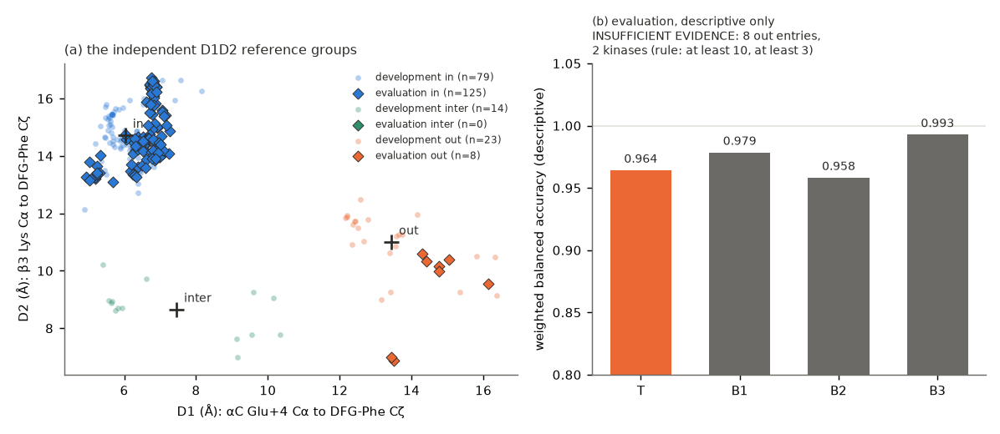

# KIN-GEN-2: Cα-only TopoFold features against equal-information baselines for DFG-in versus DFG-out groups (generated report)

Generated by `make_report.py` from `results/*.json`. **Evidence scope: structural-label recovery only.** The labels are geometric groups of static public structures; nothing here establishes function, drug response or biological validation.
Protocol `PROTOCOL.md` (frozen; amendments 1 and 2 are dated and were made before any evaluation structure was selected). It replaces the unfrozen KIN-GEN-1 draft.
**See the correction addendum `REPORT_ADDENDUM_2026-10-27.md` (error types, methodological qualifications); the outcome is unchanged.**

## Outcome

**Outcome (frozen rule): INSUFFICIENT EVIDENCE.** The evaluation yielded 133 scored entries but only 8 labelled out, from 2 kinases (JAK2 2, MET 6); the rule requires at least 10 from at least 3 kinases.
The benchmark therefore supports none of: comparable recovery, an advantage, or a Cα-only limitation. The scores below are descriptive: all four Cα-only representations separate in from out with weighted balanced accuracy 0.958 to 0.993, and the error types differ (see the correction addendum `REPORT_ADDENDUM_2026-10-27.md`).

*Figure 1. Purpose: show the reference groups used as labels and the descriptive recovery scores. (a) D1 and D2 of every development (small) and evaluation (diamond) entry, coloured by the D1D2 group (fitted on development; evaluation entries assigned to the nearest development centroid, + marks the centroids). (b) weighted balanced accuracy of the four representations on the evaluation entries. Limitation: the labels come from a full-atom rule that the Cα-only representations never see; the rule defines the labels, so it is not a performance result; the evaluation has too few out entries for any comparison; no interval or p-value is given (too few independent kinases). Source: `results/dev_model.json`, `results/eval_results.json`.*

## Reference route (selected before scoring): independent labels, not KinCoRe

Official pages re-read: the KinCoRe website data ("Last updated 2026-05-25") state no licence or terms; the GitHub standalone repositories have no licence file; the article is Creative Commons Attribution-NonCommercial-NoDerivatives License 4.0 (CC BY-NC-ND), and that licence is not established for the website data or the supplementary datasets; the paper publishes the distances D1 and D2 and the clustering method but no numeric boundaries.
Unresolved and not assumed: terms of use of the KinCoRe website data; terms of use of the KinCoRe GitHub software; whether the CC BY-NC-ND article licence extends to the supplementary datasets. **Route B** was therefore used: D1 and D2 computed here from public PDB coordinates by an independently written implementation, three groups from average-linkage clustering fitted on development data only. The groups are "D1D2 groups", not KinCoRe labels and not biological measurements. No official label, table or code was read or copied.

## Development (preparation; recorded separately)

| development kinase | UniProt | entries in / out / inter | anchor note |
|---|---|---|---|
| ABL1 | P00519 | 2 / 9 / 3 | αC Glu 286 |
| CDK2 | P24941 | 0 / 0 / 0 | αC Glu None |
| MAPK14 | Q16539 | 7 / 4 / 2 | αC Glu 71 |
| AURKA | O14965 | 27 / 0 / 9 | αC Glu 181 |
| BRAF | P15056 | 9 / 10 / 0 | αC Glu 501 |
| PRKACA | P17612 | 34 / 0 / 0 | αC Glu 92 |

Development entries: 116 (79 in, 23 out, 14 inter); group centroids (D1, D2 in Å): out (13.4, 11.0); in (6.0, 14.7); inter (7.5, 8.7). k per representation (leave-one-kinase-out): {'T': 3, 'B1': 5, 'B2': 1, 'B3': 1}; primary baseline fixed on development: **B2**.
CDK2 yielded no development entry (no unique αC Glu: almost all its entries are αC-out).

| development gate | result |
|---|---|
| G6 | pass |
| G5 | pass |
| G1 | pass |
| G2 | pass |
| G4 | pass |
| G3 | pass |
| G8 | pass |

Gates: G1 core κ/τ against numpy; G2 rigid-motion invariance; G3 Kabsch against MDAnalysis QCP; G4 role residues and shifted-mapping control; G5 controls; G6 group sizes; G8 D1/D2 against MDAnalysis; G7 (disjointness) is checked in the evaluation: pass. Two pre-evaluation amendments are documented in the protocol (float32 limit for T; anchor rules after MAPK14, AURKA and CDK2 failed; control testability).

## Evaluation selection and counts

| evaluation kinase (rank order) | UniProt | RCSB eligible entries | entries in / out / inter | kinase-domain identity to the nearest development kinase | anchor note |
|---|---|---|---|---|---|
| JAK2 | O60674 | 153 | 11 / 2 / 0 | 0.19 (ABL1) | αC Glu 898 |
| CHEK1 | O14757 | 152 | 16 / 0 / 0 | 0.08 (BRAF) | αC Glu 55 |
| MAPK1 | P28482 | 142 | 28 / 0 / 0 | 0.53 (MAPK14) related | αC Glu 71 |
| MET | P08581 | 105 | 14 / 6 / 0 | 0.23 (ABL1) | αC Glu 1127 |
| SYK | P43405 | 85 | 26 / 0 / 0 | 0.28 (ABL1) | αC Glu 420 |
| IRAK4 | Q9NWZ3 | 73 | 20 / 0 / 0 | 0.07 (BRAF) | αC Glu 233 |
| PLK1 | P53350 | 71 | 0 / 0 / 0 | 0.19 (AURKA) | αC Glu None |
| FGFR1 | P11362 | 67 | 10 / 0 / 0 | 0.21 (ABL1) | αC Glu 531 |

| evaluation entries or kinases excluded, by reason | count |
|---|---|
| a reference role unobserved | 13 |
| kinase_roles refused (role mutation or placement) | 14 |
| no PDB-format file | 40 |
| no chain maps | 3 |
| no unique contact Glu (counts {}) | 1 |
| non-standard residue in the window | 2 |
| window chain break | 5 |

## Scores (descriptive; primary baseline B2)

| representation | k (development) | weighted BA | pooled BA | AUROC of the neighbour score | TPR/TNR in kinases with out entries | development leave-one-kinase-out BA (development, not evidence) |
|---|---|---|---|---|---|---|
| T: TopoFold κ/τ | 3 | 0.964 | 0.980 | 1.000 | JAK2 1.00/1.00, MET 1.00/1.00 | 0.975 |
| B1: window Cα distances | 5 | 0.979 | 0.988 | 1.000 | JAK2 1.00/1.00, MET 1.00/1.00 | 0.872 |
| B2: local RMSD | 1 | 0.958 | 0.938 | 0.938 | JAK2 1.00/1.00, MET 0.83/1.00 | 0.881 |
| B3: all 36 Cα distances | 1 | 0.993 | 0.996 | 0.996 | JAK2 1.00/1.00, MET 1.00/1.00 | 0.801 |

*Table 1. Purpose: the same k-NN procedure for every representation (k from development, decision at half of the neighbours). The primary metric is the weighted balanced accuracy (each kinase × class cell weighted equally within its class). Limitation: 8 out entries, so one out entry changes a pooled out rate by 0.125; the in class dominates (125 entries). The score is not tuned on evaluation data; no window or feature was selected.*

Family relation: kinase-domain identity of each evaluation kinase to its nearest development kinase is in the evaluation table; 1 of 8 kinases are flagged related (identity at least 0.40); the out entries come from JAK2, MET, none of them flagged.

## What this does and does not show

- **Not established (insufficient evidence):** whether the Cα-only TopoFold representation recovers the D1D2 group better than, as well as, or worse than the baselines; whether Cα-only information limits recovery. The frozen evaluation did not reach 10 out entries from 3 kinases. Hypothesis (not tested here): entries were taken by resolution without stratifying by class, and out-type structures are a small fraction of the kinases ranked first.
- **Descriptive observation:** on this evaluation set all four representations recovered most or all out entries and almost all in entries (Table 1), so a Cα window of nine residues around the DFG motif carries enough information to recover this label in the entries examined, for in-dominated data. This is a descriptive observation, not a comparison.
- **Development note (not evidence):** on development, T had the highest leave-one-kinase-out balanced accuracy (0.975 against 0.881 for B2); development kinases are few and several are related, so this is not a performance estimate.
- The full-atom D1/D2 rule defines the labels; its agreement with them is 1 by construction.

## Resources

Evaluation: 96.5 MB of structure files downloaded (200 files; limit 100 MB), 75 CPU-s (291 s wall; limit 2 CPU-hours).
Preparation (recorded separately): development run 1 downloaded 70.1 MB (149 files), runs 2 and 3: see `results/dev_prep_run2.log` and `results/dev_prep_run3.log`; run 1 fitting and gates took 56 CPU-s.
