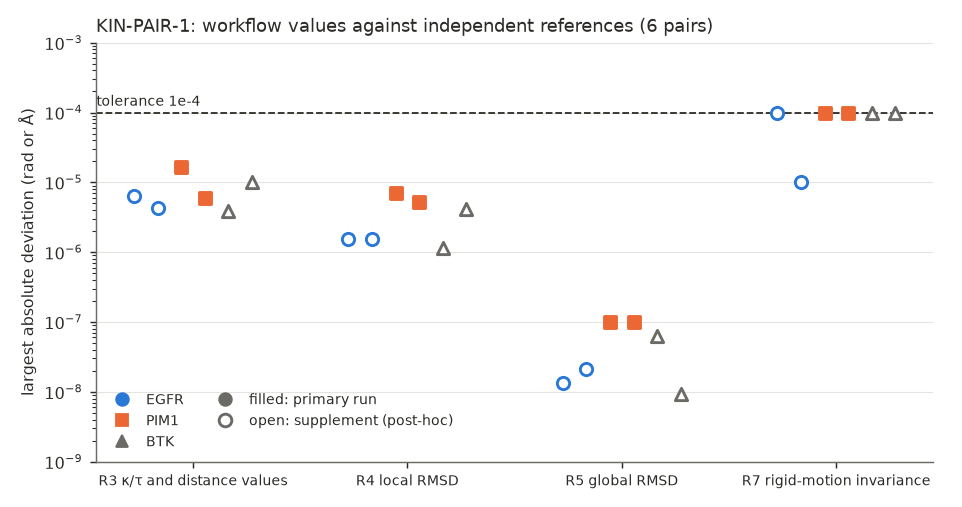
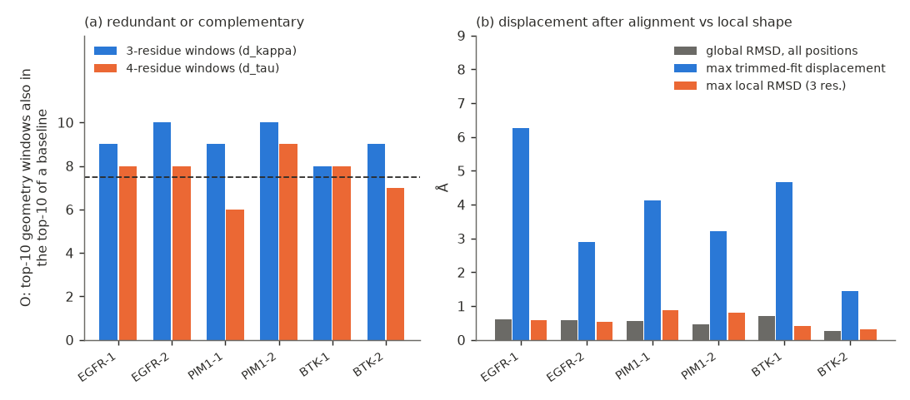

# KIN-PAIR-1: structpair on previously unused human kinases (generated report)

Generated by `make_report.py` from `results/*.json`; no number is typed here. Protocol: `PROTOCOL.md` (frozen before selection; amendments 1 and 2 are dated in it).
**Structural-analysis and engineering evaluation. It is not a test of drug efficacy, resistance, causal allostery or clinical benefit.**

## Result

**Frozen-rule study outcome: IMPLEMENTATION FAILURE.** 6 of 6 selected pairs were executed (targets: BTK, EGFR, PIM1);
2 passed all checks in the primary run; 4 are classed *implementation failure* by the frozen rule; 0 input or mapping failures.

**Cause of the 4 failures (recorded, not reinterpreted).** In EGFR-1, EGFR-2, BTK-1 and BTK-2 structpair stopped with its input error
"altlocs ['A', 'B'] tie on occupancy 0.5". The protocol had requested the optional `altloc_sensitivity: highest_occupancy`; that policy refuses a tie and aborts the whole comparison, so no check was evaluated for those pairs in the primary run.
It is a refusal designed into the adapter (its docstring: "Anything unresolved raises"; the user guide did not say so), not a numerical error, but under the frozen rule it counts. A post-hoc supplement (amendment 2) re-ran those 4 pairs once without the optional entry: **3 of 4 passed every check; BTK-2 failed only R7_rigid_motion (largest deviation 0.0001000000000015433 against 0.0001, i.e. above the tolerance by 1.5e-15)**. A deviation of this size is the 6-significant-figure resolution of the CSV outputs, not a geometric deviation. The frozen outcome is not changed by the supplement.

## Panel (selected by the frozen rules from metadata and file checks, before any TopoFold value was computed)

| rank | target | UniProt | entries eligible by metadata | status | entries examined |
|---|---|---|---|---|---|
| 1 | EGFR | P00533 | 169 | selected | 4 |
| 2 | PIM1 | P11309 | 160 | selected | 6 |
| 3 | BTK | Q06187 | 156 | selected | 10 |
| 4 | JAK2 | O60674 | 153 | not examined (panel complete) | 0 |
| 5 | CHEK1 | O14757 | 152 | not examined (panel complete) | 0 |
| 6 | MAPK1 | P28482 | 142 | not examined (panel complete) | 0 |
| 7 | MET | P08581 | 105 | not examined (panel complete) | 0 |
| 8 | SYK | P43405 | 85 | not examined (panel complete) | 0 |

Examined entries by outcome:

| status of an examined entry | count |
|---|---|
| excluded: DBREF numbering disagrees with the alignment | 8 |
| paired | 12 |

| pair | entries A / B | resolution (Å) | primary ligand | space group | RCSB mutation counts | positions | span positions not shared | frozen outcome | checks evaluated by |
|---|---|---|---|---|---|---|---|---|---|
| EGFR-1 | 8A27 / 8A2D | 1.07 / 1.11 | KY9 / KXY | C 1 2 1 / C 1 2 1 | 0 / 2 | 269 | 16 | IMPLEMENTATION_FAILURE | PASS (supplement) |
| EGFR-2 | 5UG9 / 5HG8 | 1.33 / 1.42 | 8AM / 634 | P 21 21 21 / P 21 21 21 | 3 / 3 | 280 | 4 | IMPLEMENTATION_FAILURE | PASS (supplement) |
| PIM1-1 | 8R0Q / 6NO9 | 1.7 / 1.712 | XGB / KUV | P 65 / P 65 | 1 / 0 | 266 | 7 | PASS | PASS (primary) |
| PIM1-2 | 6VRV / 6L17 | 1.74 / 1.75 | WFY / E2X | P 65 / P 65 | 0 / 0 | 270 | 1 | PASS | PASS (primary) |
| BTK-1 | 6E4F / 4RFZ | 1.15 / 1.17 | HRA / 3OV | P 21 21 2 / P 21 21 2 | 0 / 4 | 263 | 0 | IMPLEMENTATION_FAILURE | PASS (supplement) |
| BTK-2 | 7L5O / 6J6M | 1.21 / 1.25 | R1L / BA0 | P 21 21 2 / P 2 21 21 | 0 / 0 | 263 | 3 | IMPLEMENTATION_FAILURE | IMPLEMENTATION_FAILURE (supplement) |

Construct, mutation, ligand and crystal-form differences are recorded, not controlled: pairs differ in several of them at once, and the two pairs of one target are not independent. Pairs whose two entries were released on the same day (shared deposition series, so shared methods): EGFR-1.

## Agreement with independent references (tolerance 0.0001; deviations in rad or Å)

| pair | analysis | R3 d_kappa / d_tau max dev. | R3 distances max dev. | R4 local RMSD max dev. | R5 global RMSD dev. | R7 invariance max dev. | R2 window set equal | R9 exclusions equal | R7 pass | R8 pass |
|---|---|---|---|---|---|---|---|---|---|---|
| EGFR-1 | supplement | 1.5e-06 / 3.8e-06 | 6.3e-06 | 1.5e-06 | 1.3e-08 | 1.000000e-04 | yes | yes | yes | yes |
| EGFR-2 | supplement | 1.3e-06 / 2.6e-06 | 4.2e-06 | 1.5e-06 | 2.1e-08 | 1.000000e-05 | yes | yes | yes | yes |
| PIM1-1 | primary | 6.6e-06 / 7.3e-06 | 1.6e-05 | 7.1e-06 | 1.0e-07 | 1.000000e-04 | yes | yes | yes | yes |
| PIM1-2 | primary | 2.1e-06 / 3.2e-06 | 6.0e-06 | 5.3e-06 | 1.0e-07 | 1.000000e-04 | yes | yes | yes | yes |
| BTK-1 | supplement | 1.8e-06 / 3.4e-06 | 3.9e-06 | 1.1e-06 | 6.3e-08 | 1.000000e-04 | yes | yes | yes | yes |
| BTK-2 | supplement | 4.5e-06 / 3.8e-06 | 1.0e-05 | 4.1e-06 | 9.2e-09 | 1.000000e-04 | yes | yes | NO (resolution-limited, see text) | yes |

*Figure 1. Purpose: show that the workflow's values agree with independent recomputation from the raw coordinates. Shows the largest absolute deviation per check and pair (log scale); filled markers are primary runs, open markers the post-hoc supplement. Limitation: CSV outputs carry 6 significant figures, so deviations near 1e-5 to 1e-4 are rounding; the invariance deviation of about 1e-4 is at that resolution. Source: `results/KIN-PAIR-1_results.json`, `results/KIN-PAIR-1_supplement.json`.*

The independent window sets and exclusion sets equal the workflow's for every evaluated pair (R2 and R9); the shifted-mapping control collapses the residue-name identity to at most 0.075 for every chain (R8). Displacement (R6) could not be compared: every entry contributed one chain, so structpair wrote no displacement channel (the independent trimmed-fit displacement is reported below).

## Local geometry, baselines and displacement (descriptive)

| pair | 3-residue windows | 4-residue windows | global RMSD (Å) | max trimmed-fit displacement (Å) at residue | max rmsd3 / rmsd4 (Å) | Spearman displacement vs rmsd3 |
|---|---|---|---|---|---|---|
| EGFR-1 | redundant (O=9, ρ vs rmsd3 0.81) | redundant (O=8, ρ vs rmsd4 0.67) | 0.606 | 6.25 at A:857/A:857 | 0.58 / 1.89 | 0.22 |
| EGFR-2 | redundant (O=10, ρ vs rmsd3 0.99) | redundant (O=8, ρ vs rmsd4 0.78) | 0.590 | 2.90 at A:874/A:874 | 0.53 / 0.72 | 0.25 |
| PIM1-1 | redundant (O=9, ρ vs rmsd3 0.98) | complementary (O=6, ρ vs rmsd4 0.79) | 0.556 | 4.12 at A:48/A:48 | 0.89 / 0.89 | 0.44 |
| PIM1-2 | redundant (O=10, ρ vs rmsd3 0.75) | redundant (O=9, ρ vs rmsd4 0.73) | 0.451 | 3.22 at A:101/A:101 | 0.80 / 1.56 | 0.31 |
| BTK-1 | redundant (O=8, ρ vs rmsd3 0.88) | redundant (O=8, ρ vs rmsd4 0.76) | 0.706 | 4.67 at A:412/A:412 | 0.41 / 0.73 | 0.51 |
| BTK-2 | redundant (O=9, ρ vs rmsd3 0.89) | complementary (O=7, ρ vs rmsd4 0.77) | 0.275 | 1.43 at A:414/A:414 | 0.30 / 0.35 | 0.49 |

*Figure 2. Purpose: compare TopoFold local geometry with the equal-information baselines and show displacement after alignment separately from local shape change. (a) O is the number of the 10 largest geometry windows that are also among the 10 largest of either baseline (8 or more, above the dashed line: redundant). (b) global RMSD, the largest trimmed-fit (20 %) displacement and the largest 3-residue local RMSD. Limitation: descriptive, one pair per bar, not a test; complementary geometry is not novelty or biological superiority. Source: `results/KIN-PAIR-1_results.json`, `results/KIN-PAIR-1_supplement.json`.*

## Sensitivity to the alternate-location choice (independent, supplement pairs)

| pair | mapped positions with an altloc Cα | same valid windows | max change d_kappa / d_tau (rad) | max change distances (Å) | max change local RMSD (Å) | smallest top-10 overlap |
|---|---|---|---|---|---|---|
| EGFR-1 | 29 | yes | 0.047 | 0.059 | 0.039 | 10 of 10 |
| EGFR-2 | 11 | yes | 0.154 | 0.106 | 0.062 | 10 of 10 |
| BTK-1 | 4 | yes | 0.192 | 0.247 | 0.147 | 9 of 10 |
| BTK-2 | 34 | yes | 0.186 | 0.228 | 0.124 | 7 of 10 |

Replacing location A by B at residues that have both changes window values by the amounts above; the set of valid windows is unchanged in every pair. Chain sensitivity could not be examined (one chain per entry in every pair).

## Summary of the descriptive comparison

Across the 12 pair-by-window-size cases: 10 redundant with the equal-information baselines, 2 complementary, 0 insufficient evidence
(3-residue windows: 6 of 6 redundant; 4-residue windows: 4 of 6 redundant). In every pair the largest trimmed-fit displacement is 4.0 to 11.5 times the largest 3-residue local RMSD, so displacement after alignment and local shape change are different quantities in these data.
These are counts over 6 non-independent pairs, a descriptive rule and not a test; "complementary" means only that at least 3 of the 10 largest geometry windows are not among the baselines' top windows.

## Resources

Execution: 85.2 CPU-s (37.9 s wall) in the primary run and 74.5 CPU-s in the supplement; selection 1.9 CPU-s;
20 PDB files, 7.46 MB downloaded by the corrected selection run (the first, defective selection run downloaded a similar amount; total well under the 100 MB limit); installation excluded.

## Limits

The panel is small (6 pairs, 3 targets, structures chosen by resolution and ligand difference), and pairs of one target share laboratories and ligand series. Phosphorylated residues (TPO, SEP, PTR) are not read by the adapter and are excluded from the correspondence.
Nothing here shows a biological state, ligand or mutation effect, novelty, or user time savings.
