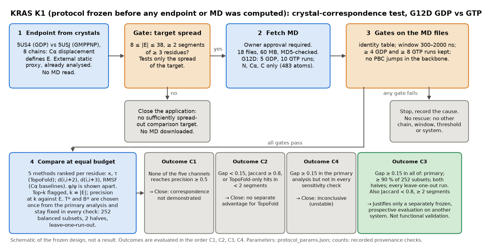

# KRAS K1 protocol, version 1 (frozen at step S0, 2026-10-25)

*Schematic of the frozen design, not a result. Caption, purpose and limits:
[`K1_design_and_decisions_2026-10-25_caption.md`](../../../docs/figures/kras_k1/K1_design_and_decisions_2026-10-25_caption.md).*

**Status.** This text, [`protocol_params.json`](protocol_params.json), the endpoint implementation
(`k1_endpoint.py`) and its tests are frozen by [`results/KRAS-K1_freeze.json`](results/KRAS-K1_freeze.json) before any crystal
endpoint is computed. No MD trajectory has been downloaded, opened or scored. It supersedes the draft of commit 2b75a0d
(changes in section 8). The only simulation-related data read so far are metadata, 92-byte XTC frame headers (248,520 B
for 15 files), the article text, the S1 Table PDF and the labels (never the values) of the authors' PyInteraph files;
see [`results/k1_provenance_checks.json`](results/k1_provenance_checks.json). All parameters are design choices fixed
before the data were read. They are not calibrated values, and no significance is claimed.

## 1. The question, in plain language

KRAS is an oncology target. Published simulations of the G12D mutant exist with GDP bound (5 runs) and with GTP bound
(10 runs). Two published crystal structures show the same mutant with GDP (5US4) and with a GTP analogue (5USJ). The
question is whether the residues where TopoFold sees the biggest GDP-versus-GTP difference in the simulations are the
residues that differ between the two crystal structures, and whether TopoFold finds them better than simple Cα distance
measures do when every method may flag the same number of residues.

**Single primary question.** For KRAS G12D, using only the N, Cα, C backbone of the public simulations, at an equal budget
of k residues, does the better TopoFold descriptor (κ or τ, called T\*) recover the endpoint residues better than the
strongest equal-information Cα baseline (d(i,i+2), d(i,i+3) or RMSF, called B\*)?

**Evidence class of the endpoint.** 5US4 and 5USJ are external static structural evidence: published by other groups, with
no TopoFold involvement in their creation. They are **not held out**: the developers already analysed this pair with
TopoFold descriptors during KRAS-STRUCT-2 (frozen and run 2026-10-24). The endpoint is therefore not a prospective test,
not independent validation and not functional ground truth. It is a fixed external structural proxy, defined from
per-residue Cα displacement (not from TopoFold descriptors) and computed once before any MD coordinate is read.

## 2. What the checks established

| Item | Evidence | Strength |
|---|---|---|
| Data, terms | Zenodo 10.5281/zenodo.1346073, CC BY 4.0, open access; Pantsar et al., PLoS Comput Biol 14:e1006458 (2018), doi:10.1371/journal.pcbi.1006458 | verified from the API and the article |
| Completeness | 85 trajectory files = 85 replicas of S1 Table = "170 µs (85 × 2 µs)" in the article; per-system replica counts equal S1 Table in 14 of 14 systems | supports the file set being complete; does not validate any single label |
| Replica identity (mutant, nucleotide) | author-assigned file names only (`GDP_G12D_<n>.xtc`, `GTP_G12D_<n>.xtc`) | **author-asserted; not verifiable from the backbone files** |
| Mutant, system level | the authors' PyInteraph labels name Asp at position 12 in both G12D systems (3 labels each) | partial, system level; nothing on nucleotide or on single replicas |
| Nucleotide | no GDP, GTP or Mg label occurs in those files; S1 Table system sizes (G12D: 32,741 atoms with GDP, 32,743 with GTP) cannot be matched to 483-atom backbone files | **not evidenced beyond the file names** |
| Files | 15 G12D files: 483 atoms each, first frame 0 ps, 1000 ps interval; 14 end at 2,000 ns; `GTP_G12D_1.xtc` ends at 2,315 ns | header fields only; frame counts are implied, not counted |
| Topology | shared `backbone_4-164.pdb` (MD5 equals Zenodo's): 161 residues, residues 4–164 equal UniProt P01116-2 at offset 0 except residue 12 labelled ALA | exact sequence match; the label at 12 is a topology convention (N, Cα, C do not depend on the side chain) |

Backbone-only files can verify atom count and order, the time axis, run length, the box at t = 0, file integrity against
the published MD5, backbone continuity and unit scale (consecutive Cα distances, at execution) and numbering by
sequence. They cannot verify the residue-12 side chain, the nucleotide, Mg²⁺, ions, protonation, force field or
temperature. Per-replica mutant and nucleotide identity rests on the dataset's file names. That is an assumption, recorded
and not resolved. No replica is relabelled or dropped because of how it behaves.

## 3. Resolved and open points

**Replica preparation and initialisation (article Methods and S1 Table footnote).** All systems start from the GDP-bound
structure 4OBE (1.24 Å, 169 of 188 residues). Mutants were built from it with Maestro. For the GTP systems "the GDP was
replaced with GTP", and one crystal water that occupied the γ-phosphate position was not kept. After minimisation, four
equilibration stages were run; an equilibrated system was then simulated at 350 K with restraints on K-Ras, crystal
waters, Mg and the ligand, and every 50 ps one frame was picked as the starting structure of a replica. Consequences:
- replicas of a system are not independent starts (one equilibrated system, one restrained backbone): conditionally
  dependent at best;
- the GTP ensembles start from a GDP-state backbone and may not relax in about 2 µs;
- whether velocities were regenerated is **not stated** (open);
- the t = 0 box edge differs between runs of one system (x edge: GDP 7.005–7.111 nm over 5 runs; GTP 7.009–7.030 nm over
  10 runs), consistent with different starting frames; recorded only as an observation.

**Unequal replicas, common window, temporal instability.**
- The run is the unit. No frame-level p-value or interval is computed (D33).
- Common window 300–2000 ns at 1 ns frames (the article discarded the first 300 ns); `GTP_G12D_1` is cut at 2000 ns. A run
  lacking any frame of the window, or with an interval outside 1 ns ± 0.01 ns, is excluded with its cause; fewer than 4 GDP
  or 8 GTP retained runs stops the study.
- Primary analysis: all retained runs. Sensitivity analyses (section 4.5): balanced subsets, leave-one-run-out and the two
  predefined halves 300–1150 and 1150–2000 ns. Instability is judged only by the C3 conditions, never by a post-hoc threshold.

**Prior exposure and limits of 5US4/5USJ.**
- KRAS-STRUCT-2 (TopoFold descriptors on this pair) found the contrast concentrated in a block around residues 29–39
  (Switch I), with smaller windows at 25–27, 50–53 and 57–59 and chain-dependent windows at 72–76 and about 100–125, where
  copy-to-copy differences inside 5USJ match or exceed the GDP-versus-GMPPNP difference. The coarse shape of the endpoint is
  therefore known to the developers.
- Switch II (residues 60–67) is unobserved in at least one chain and is excluded; the scored set is 153 residues (4–59 and
  68–164). The endpoint says nothing about Switch II.
- 5USJ carries GMPPNP, a non-hydrolysable analogue, while the simulations use GTP. The crystals differ in space group
  (H3 with 2 chains versus P1 with 6), pH (9.1 versus 5.5), and the GDP drop contained a small-molecule additive with 4 % DMSO
  (no density reported). The contrast is not a pure nucleotide effect.
- The article reports that individual replicas vary about as much as different systems in the switch-region RMSF, and distinct
  GDP and GTP dynamics in principal components. No RMSF spreadsheet and no coordinate was read for this protocol.
- On a different system (ABL-MYR-1b) κ and d(i,i+2) flagged nearly the same residues (Jaccard 0.97). The expectation that κ
  is redundant with its matched baseline is a prior; it is why the Jaccard condition exists.

## 4. Design (all parameters in `protocol_params.json`)

### 4.1 Endpoint E (crystals only, computed once before any MD file is opened)
- **Inputs.** The local copies of 5US4 (chains A, B) and 5USJ (chains A–F) used by KRAS-STRUCT-2. Each file's SHA-256 must
  equal the value recorded in that study's `run_spec.json`. Identity checks: ATOM records only; no alternate locations or
  insertion codes; Asp at residue 12 in all 8 chains; residue names equal the MD topology sequence at every scored residue
  except residue 12.
- **Scored residues.** Cα observed in all 8 chains and inside the MD topology range 4–164. The observed set within 1–166
  must equal the frozen KRAS-STRUCT-2 set (1–59 and 68–166); the expected count after the intersection is 153.
- **Pair displacement.** For each chain pair, Kabsch superposition (proper rotation, float64) on all scored Cα; drop the
  floor(0.2 n) most displaced residues (ties: lower residue number dropped first); refit once; the displacement of every
  scored residue under the refit is the pair displacement.
- **Between-state value b.** Mean over the 12 GDP × GMPPNP pairs. **Within-state value w.** Maximum over the 16 same-entry
  pairs (1 in 5US4, 15 in 5USJ).
- **Positive rule.** A scored residue is endpoint-positive if b ≥ max(1.0 Å, 2 × w) at that residue.
- **Segments.** Two positives belong to one segment if their residue numbers differ by at most 3 (a gap of up to 2
  residues). A segment's length is its number of positive residues. The same rule defines the segments used in 4.5.
- **Sensitivity (reported only; never changes E, the gate or the decision).** (a) b from the single pair 5US4 A × 5USJ A;
  (b) b as the median instead of the mean over the 12 pairs; each with the same w and the same rule.

### 4.2 Adequacy gate (step S2)
E passes if 8 ≤ |E| ≤ 38 (floor(0.25 × 153)) and E has at least 2 segments of at least 3 residues, all bounds inclusive.
**What the gate means.** It determines only whether the crystal proxy contains a sufficiently distributed comparison
target. It does not demonstrate that the endpoint can discriminate methods; that question is open until the outcomes of
section 5 are evaluated. If the gate fails, K1 closes with the recorded reason; no MD is downloaded, and no alternative
chain, threshold, endpoint or system is tried.

### 4.3 Methods (equal information: same residues, same frames, backbone coordinates only)
TopoFold κ (3-point) and τ (4-point); Cα baselines d(i,i+2) (matched to κ), d(i,i+3) (matched to τ) and RMSF. The φ/ψ JS
distance is a stronger-information comparator reported apart and never used in a decision (a local stand-in for a
PENSA-style torsion comparison; PENSA is not run). Physics: κ and τ respond to bending and torsion of the Cα trace; they do
not respond to side-chain rotamers, nucleotide or Mg²⁺ contacts or water, nor to a peptide-plane flip with a fixed Cα trace
(φ/ψ does).

### 4.4 Scoring, flagging and ties
- **Per-residue score.** For each channel, the maximum over the windows covering the residue of E = median cross-condition
  run-pair distance minus the larger within-condition median. The existing statistic is reused; none of the ABL thresholds
  or "robust in both sets" filters is.
- **Flagging.** Each method flags its top k = |E| residues. Ties in score are resolved by lower residue number first, for
  every method. A residue without a finite score is never flagged; if a method has fewer than k finite scores it flags all
  of them and the shortfall counts as misses (the denominator stays k).
- **Metric.** Precision at k = m / k, with m the number of flagged residues in E (exact residue matching). It is an exact
  fraction: all comparisons below use integer arithmetic. Chance level is |E| / 153.

### 4.5 Channel selection and sensitivity
- **T\* and B\* are chosen once**, from the full primary analysis (all retained runs, window 300–2000 ns), as the κ/τ
  channel and the d(i,i+2)/d(i,i+3)/RMSF channel with the highest precision at k. Equal precision is resolved by the
  candidate order κ, τ and d(i,i+2), d(i,i+3), RMSF. Both choices are made after the fact, which favours the baselines.
- **T\* and B\* stay fixed in every sensitivity calculation:** the balanced subsets, the two time halves and the
  leave-one-run-out recomputations. No winning channel is reselected inside any of them.
- **Balanced subsets:** all subsets of n_GDP retained GTP runs against all retained GDP runs (252 when all 15 runs are
  retained). **Leave-one-run-out:** every retained run is left out once (15 recomputations). **Halves:** 300–1150 and
  1150–2000 ns.

## 5. Ordered decision rule
Let m_T and m_B be the matches of T\* and B\* in the primary analysis. "Gap ≥ 0.15" means 20 (m_T − m_B) ≥ 3k.
1. **C1.** None of the five decision channels has 2m ≥ k in the primary analysis: correspondence is not demonstrated. Close.
2. **C2.** Not C1, and at least one of: the primary gap is below 0.15; the **Jaccard condition** fails; the **segment
   condition** fails. Close: no separate advantage for TopoFold.
   - *Jaccard condition* (evaluated in the primary analysis only): the top-k flagged sets of T\* and of the baseline matched
     to T\* (κ to d(i,i+2), τ to d(i,i+3)), not restricted to E, must satisfy 5 |∩| < 4 |∪| (a Jaccard index below 0.8); otherwise T\* is
     redundant with its matched baseline.
   - *Segment condition* (evaluated in the primary analysis only): let X be the residues of E that T\* flags and B\* does not;
     X must lie in at least 2 distinct segments of E (the merge rule of 4.1).
3. **C3.** Not C1, not C2, and the gap T\* − B\* is **at least 0.15 in every one of**: the primary analysis; at least 90 %
   of the balanced subsets (at least 227 of 252; in general ceil(0.9 N)); both time halves; every leave-one-run-out
   recomputation. A merely positive gap is insufficient.
4. **C4.** Not C1, not C2, and C3 not met: inconclusive (unstable). Close.

**Stop conditions.** Endpoint gate fails; any file's identity, atom count, interval or backbone continuity fails; a group
falls below 4 GDP or 8 GTP runs; download or compute exceeds the budget. A stop is recorded with its cause. There is no
rescue by changing chains, windows, thresholds, k, channels, residues or system (the G12V and wild-type systems of the same
record are not a fallback).

**Bounded budget.** Download at most 100 MB (planned 18 files, 59,986,475 B); storage at most 1 GB; compute at most
20 CPU-minutes and 1 hour of wall time (ABL-MYR-1b used 989 CPU-s for 40 runs of a larger topology; the K1 figure is an
extrapolation); figures at most 60 CPU-s and 5 MB.

**Execution order.** (S0) freeze, with SYNTHETIC tests passing; (S1) compute E from the local crystals; (S2) the adequacy
gate; (S3) fetch and verify the 18 files, only with owner approval; (S4) gates, scoring and the ordered rule; (S5) report
every outcome, including negative ones.

## 6. Is the crystal comparison defensible?
As a structural correspondence analysis against an external static proxy, yes, if stated narrowly: it asks whether the
simulated nucleotide contrast points to residues that also differ between two published crystal structures of the
corresponding states. It is not independent functional validation and not held out: the crystals are static and
lattice-dependent, the analogue and conditions differ, Switch II is missing, the pair was already analysed during
development, and a residue identical in the crystals can still differ in its dynamics. A low agreement cannot separate a
method failure from a limit of the proxy. The informative quantity is the comparison between methods against the same proxy.

## 7. What each outcome means
- **C3 would justify only a separately frozen, genuinely prospective evaluation on another system** with its own endpoint
  that has not been analysed during development (and, if inference is wanted, a method calibrated in advance on matched
  SYNTHETIC data, D33). It is not evidence of functional or clinical validity and not a product claim.
- **C1, C2, C4 and any gate or stop close this application**, with no search for a favourable result. A C2 would be the second
  system, after ABL-MYR-1b, in which equal-information Cα baselines cover TopoFold; it would be recorded as such.
- The protocol does not test activity, resistance, drug response or biology.

## 8. Changes from the 2b75a0d draft
(1) the endpoint is described as external, already exposed, not held out; (2) the gate meaning is limited to the
distribution of the target; (3) T\* and B\* are selected once with fixed tie-breaking and stay fixed in all sensitivity
analyses; (4) C3 requires the gap ≥ 0.15 in the primary analysis, ≥ 90 % of subsets, both halves and every leave-one-run-out
run (the draft's "same sign" is withdrawn); (5) the segment and Jaccard conditions are defined exactly and the Jaccard
condition is evaluated in the primary analysis; (6) tie and boundary handling are fixed (score ties, equal precision,
threshold equality, gate bounds, segment length, exact-fraction comparisons); (7) the C3 reading is restricted to a
genuinely prospective evaluation on another system. The files were renamed from `*_DRAFT*`; the draft is in Git history.
