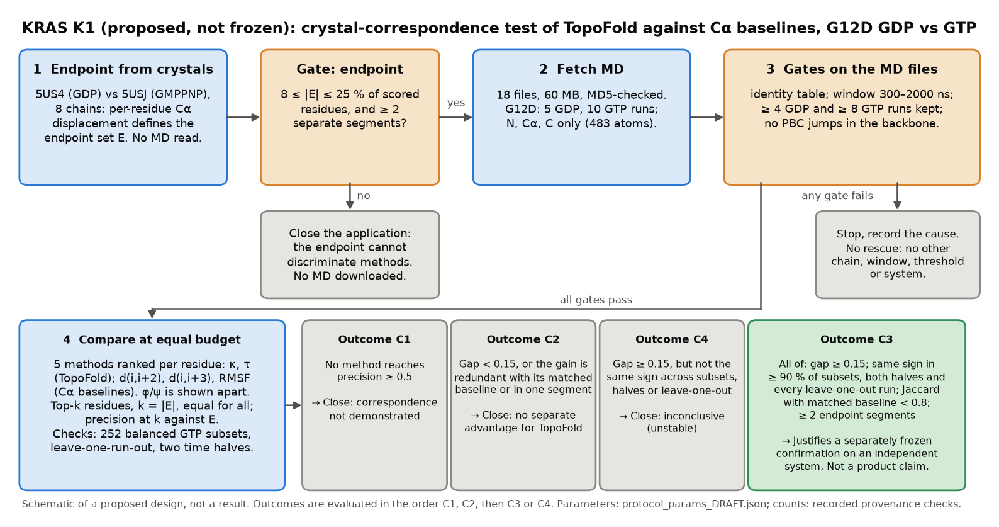

# KRAS K1 protocol draft (2026-10-25): NOT frozen, nothing executed

*Schematic of a proposed design, not a result. Caption, purpose and limits:
[`K1_design_and_decisions_DRAFT_2026-10-25_caption.md`](../../../docs/figures/kras_k1/K1_design_and_decisions_DRAFT_2026-10-25_caption.md).*

**Status.** This is a draft for owner review (D68). No MD coordinate was read or scored, no crystal endpoint was computed
and no MD trajectory was downloaded. The only data read were metadata, 92-byte XTC frame headers (248,520 B in total,
for 15 files), the article full text (Europe PMC XML, 188 kB), the 24 kB S1 Table PDF and the 123 kB PyInteraph archive
(labels only, never values). A 37 MB Europe PMC bundle of the article's supplementary files was fetched once to extract
S1 Table; its figure files were not opened. Every number below is
read from [`results/k1_provenance_checks.json`](results/k1_provenance_checks.json),
[`../next_app_feasibility/results/feasibility_metadata.json`](../next_app_feasibility/results/feasibility_metadata.json) or
the parameter file [`protocol_params_DRAFT.json`](protocol_params_DRAFT.json). The parameters are design choices fixed
before any data are read. They are not calibrated values.

## 1. The question, in plain language

KRAS is an oncology target. Published simulations of the G12D mutant exist with GDP bound (5 runs) and with GTP bound
(10 runs). Two independent crystal structures show the same mutant with GDP (5US4) and with a GTP analogue (5USJ). The
question is whether the residues where TopoFold sees the biggest GDP-versus-GTP difference in the simulations are the
residues that differ between the two crystal structures, and whether TopoFold finds them better than simple Cα
distance measures do when every method may flag the same number of residues.

**Single primary question.** For KRAS G12D, using only the N, Cα, C backbone of the public simulations, at an equal
budget of k residues, does the better of TopoFold's two descriptors (κ, τ) recover the endpoint residues better than the
strongest equal-information Cα baseline (d(i,i+2), d(i,i+3), RMSF)?

This is a *structural correspondence* analysis. It is not independent functional validation (section 5).

## 2. What the checks established

| Item | Evidence | Strength |
|---|---|---|
| Data, terms | Zenodo 10.5281/zenodo.1346073, CC BY 4.0, open access; Pantsar et al., PLoS Comput Biol 14:e1006458 (2018), doi:10.1371/journal.pcbi.1006458 | verified from the API and the article |
| Completeness | 85 trajectory files = 85 replicas of S1 Table = "170 µs (85 × 2 µs)" in the article; per-system replica counts equal S1 Table in 14 of 14 systems | supports the file set being complete; does not validate any single label |
| Replica identity (mutant, nucleotide) | author-assigned file names only (`GDP_G12D_<n>.xtc`, `GTP_G12D_<n>.xtc`; the record states the last number is the replica) | **author-asserted; not verifiable from the backbone files** |
| Mutant, system level | the authors' PyInteraph labels name Asp at position 12 in both G12D systems (3 labels each) and Arg and Val in the G12R and G12V systems | partial, system level; says nothing on nucleotide or on single replicas |
| Nucleotide | no GDP, GTP or Mg label occurs in the PyInteraph files; S1 Table gives system sizes (G12D: 32,741 atoms with GDP, 32,743 with GTP) that cannot be matched to 483-atom backbone files | **not evidenced beyond the file names** |
| Files | 15 G12D files: 483 atoms each, first frame at 0 ps, 1000 ps interval; 14 end at 2,000 ns (2,001 frames implied); `GTP_G12D_1.xtc` ends at 2,315 ns (2,316 frames implied), which the article's "2 µs" does not describe | header fields only; frame counts are implied, not counted |
| Topology | the shared `backbone_4-164.pdb` (MD5 equals Zenodo's): 161 residues, 483 atoms, residues 4–164 equal UniProt P01116-2 (KRAS4B) at offset 0 with one exception, residue 12 labelled ALA | verified by exact sequence match; the label at 12 is a topology convention, since N, Cα, C do not depend on the side chain |

**What backbone-only files can verify.** Atom count and order, the time axis, run length, the box at t = 0, file
integrity against the published MD5, backbone continuity and unit scale (to be checked at execution from consecutive
Cα distances), and numbering by sequence. **What they cannot verify.** The residue-12 side chain, the nucleotide, Mg²⁺,
ions, protonation, force field and temperature. Per-replica mutant and nucleotide identity therefore rests on the
dataset's file names. That is recorded as an assumption, not resolved. No replica is relabelled or dropped because of how
it behaves.

## 3. Resolved and open points

**Replica preparation and initialisation (article Methods and S1 Table footnote).** All systems start from the GDP-bound
KRAS structure 4OBE (1.24 Å, 169 of 188 residues). Mutants were built from it with Maestro, and for GTP systems "the GDP
was replaced with GTP", and in the GTP systems one crystal water that occupied the γ-phosphate position was not kept. After minimisation, four equilibration
stages were run; an equilibrated system was then simulated at 350 K with restraints on K-Ras, crystal waters, Mg and the
ligand, and every 50 ps one frame was picked as the starting structure of a replica. Consequences:
- replicas of a system are not independent starts: they share one equilibrated system and one restrained backbone, so they
  are conditionally dependent at best;
- the GTP ensembles start from a GDP-state backbone and may not relax in about 2 µs;
- whether velocities were regenerated is **not stated** (open);
- the t = 0 box edge differs between runs of one system (x edge: GDP 7.005–7.111 nm over 5 runs; GTP 7.009–7.030 nm over
  10 runs), consistent with different starting frames and recorded only as an observation.

**Unequal replicas, common window, temporal instability.**
- The run is the unit. No frame-level p-value or interval is computed (D33).
- Common window 300–2000 ns at 1 ns frames (the article discarded the first 300 ns). `GTP_G12D_1` is cut at 2000 ns.
  A run lacking any frame of the window, or with an interval outside 1 ns ± 0.01 ns, is excluded with its cause; fewer than
  4 GDP or 8 GTP retained runs stops the study (both groups, as in the ABL-MYR-1b amendment).
- Primary analysis uses all retained runs. Sensitivity: all 252 balanced subsets (5 of 10 GTP runs against the 5 GDP
  runs), leave-one-run-out over every retained run, and the two halves 300–1150 and 1150–2000 ns.
- Instability is not diagnosed from a threshold. An advantage is only claimed if the sign of the gap is the same in all of
  these (outcome C3); otherwise the outcome is C4.

**Prior exposure and limits of 5US4/5USJ.**
- The developers have analysed this pair with TopoFold descriptors (KRAS-STRUCT-2, frozen and run 2026-10-24): the
  contrast concentrates in a block around residues 29–39 (Switch I), with smaller windows at 25–27, 50–53 and 57–59, and
  chain-dependent windows at 72–76 and about 100–125, where copy-to-copy differences inside 5USJ match or exceed the
  GDP-versus-GMPPNP difference. The endpoint's coarse shape is therefore known. For that reason the endpoint is defined
  from per-residue Cα displacement, not from TopoFold descriptors, and is computed once, before any MD coordinate is
  read.
- Switch II (residues 60–67) is unobserved in at least one chain and is excluded; the scored set is 153 residues (4–59 and
  68–164). The endpoint cannot say anything about Switch II.
- 5USJ carries GMPPNP, a non-hydrolysable analogue, while the simulations use GTP. The crystals differ in space group
  (H3 with 2 chains versus P1 with 6), pH (9.1 versus 5.5), and the GDP drop contained a small-molecule additive with 4 % DMSO (no density reported), so the
  contrast is not a pure nucleotide effect.
- The authors' own paper reports that individual replicas vary about as much as different systems in the switch-region
  RMSF, and distinct GDP and GTP dynamics in principal components. Neither the RMSF spreadsheets nor any coordinate was read
  for this draft.
- On a different system (ABL-MYR-1b), κ and d(i,i+2) flagged nearly the same residues (Jaccard 0.97). The expectation that
  κ is redundant with its matched baseline is a prior, and it is why a non-redundancy condition is in the rule.

## 4. Design (parameters in `protocol_params_DRAFT.json`)

**Endpoint E (crystals only, computed before any MD file is opened).** Superpose the 8 chains (2 of 5US4, 6 of 5USJ) on the
scored Cα (drop the 20 % most displaced, refit once). A scored residue is endpoint-positive if its between-state mean Cα
displacement is at least max(1.0 Å, 2 × the largest within-state chain-pair displacement at that residue). **Adequacy
gate:** 8 ≤ |E| ≤ 38 (25 % of 153) and at least 2 segments of at least 3 residues (positives merged across gaps of up to
2). If it fails, the application closes for method comparison and no MD is downloaded.

**Methods (equal information: same residues, same frames, backbone coordinates only).** TopoFold κ (3-point) and τ
(4-point); Cα baselines d(i,i+2) (matched to κ), d(i,i+3) (matched to τ) and RMSF; φ/ψ JS distance, a stronger-information
comparator reported apart and not used in any decision (it stands in for a PENSA-style torsion comparison; PENSA itself is
not run). Physics: κ and τ respond to bending and torsion of the Cα trace; they do not respond to side-chain rotamers,
nucleotide or Mg²⁺ contacts, or water, and not to a pure peptide-plane flip with a fixed Cα trace (φ/ψ does).

**Per-residue score.** For each channel and window, the existing statistic E = median cross-condition run-pair distance
minus the larger within-condition median (the function is reused; none of the ABL thresholds or "robust in both sets"
filters is). A residue's score is the maximum over the windows covering it. Residues are ranked, and each method flags its
top k = |E| residues, so no method gains from flagging more.

**Metric.** Precision at k (exact residue matching, no tolerance). Chance level is |E| / 153, between 0.052 (|E| = 8) and
0.248 (|E| = 38).

**Ordered decision rule.** T\* is the better of κ and τ; B\* is the best of the three Cα baselines (both chosen after the
fact, which favours the baselines).
1. **C1.** No method (baselines included) reaches precision 0.5: correspondence is not demonstrated. Close.
2. **C2.** T\* minus B\* is below 0.15 (2 to 6 residues for k = 8 to 38), or the gain is redundant with the matched
   baseline (Jaccard of the top-k sets of 0.8 or more), or the extra hits lie in one segment. Close: no separate advantage.
3. **C3.** Otherwise, if the gap has the same sign in at least 90 % of the 252 balanced subsets, in both halves and in every
   leave-one-run-out recomputation. Justifies further development. It is not a product claim.
4. **C4.** Otherwise: inconclusive (unstable). Close.

Margins 0.15, 0.5, 0.8 and 90 % are declared design choices. They are not calibrated, and with at most 15 runs and
contiguous residues the residue-level sample is smaller than it looks, so no significance is claimed.

**Stop conditions.** Endpoint gate fails; any file's identity, atom count, interval or backbone continuity fails; a group
falls below 4 GDP or 8 GTP runs; the download or compute exceeds the budget. A stop is recorded with its cause. There is
no rescue by changing chains, windows, thresholds, k, channels, residues or system (the G12V and wild-type systems of the
same record are not a fallback).

**Bounded budget.** Download at most 100 MB (planned 18 files, 59,986,475 B); storage at most 1 GB; compute at most
20 CPU-minutes and 1 hour of wall time (ABL-MYR-1b used 989 CPU-s for 40 runs of a larger topology; the K1 figure is an
extrapolation); figures at most 60 CPU-s and 5 MB.

**Execution order, each step gated.** (S0) owner approves freezing the protocol, the hash is recorded, and a SYNTHETIC test
suite for the K1 runner passes; (S1) compute E from the local crystals only and record it; (S2) the adequacy gate; (S3)
fetch and verify the 18 files; (S4) gates, then scoring and the ordered rule; (S5) report all outcomes, including
negative ones.

## 5. Is the crystal comparison defensible?

As a structural correspondence analysis, yes, if it is stated narrowly: it asks whether the simulated nucleotide contrast
points to the residues that differ between two independent crystal structures of the corresponding states. It is not
independent functional validation, because the crystals are static and lattice-dependent, the analogue and the
conditions differ, Switch II is missing, and a residue that is identical in the crystals can still differ in its dynamics.
A low agreement cannot separate a method failure from a limit of the crystal proxy. What is informative is the
comparison between methods against the same proxy.

## 6. What each outcome means

- **Justifies further development:** only C3, and only as a separately frozen confirmation on an independent system with
  its own endpoint (and, if inference is wanted, a method calibrated in advance on matched SYNTHETIC data, D33).
- **Closes this application, with no search for a favourable result:** C1, C2, C4, and any gate or stop. A C2 would be the
  second system, after ABL-MYR-1b, in which equal-information Cα baselines cover TopoFold; it would be recorded as such.
- This protocol does not test activity, resistance, drug response or biology, and no claim beyond the stated outcome is made.

## 7. Owner decision

Whether to approve freezing and executing K1, which includes the 60 MB download. Nothing is sent externally. Contacting
the dataset authors to confirm replica labels and velocity handling is optional, is not needed to run, and would be an
owner action.
