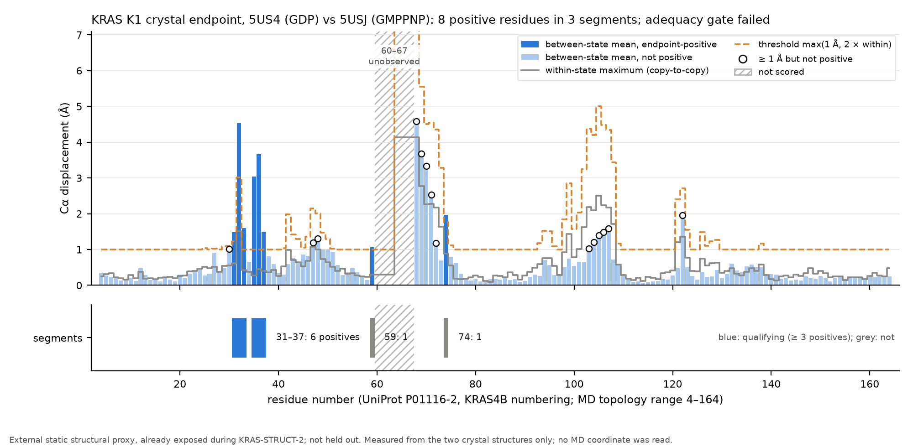

# Figure: KRAS K1 crystal endpoint (2026-10-25)

**Purpose.** To show, residue by residue, how the frozen crystal-only endpoint of KRAS K1 was formed and why its adequacy gate
failed.

**What it shows.** For the 153 scored residues, the mean Cα displacement between the 5US4 (GDP) and 5USJ (GMPPNP)
chains (bars; 12 chain pairs), the largest displacement between copies of the same entry (grey line;
16 pairs), and the frozen threshold max(1 Å, 2 × within-state) (dashed). Residues whose
bar reaches the threshold are the 8 endpoint-positive residues (dark bars). Merged segments (gap of up to
2 residues): 31–37 (6); 59 (1); 74 (1). The gate needs at least 2 segments of at least 3 residues; 1 qualify.
Residues 60–67 are unobserved in at least one chain and are not scored. Open circles mark residues with a
mean displacement of at least 1 Å that are not positive: for them the within-state value is more than
0.5 of the between-state mean, so the threshold is not reached. The dashed threshold runs above the plotted range at
residue 68.

**Main limitation.** The endpoint is an external static structural proxy that the developers already analysed during
KRAS-STRUCT-2; it is not held out and not functional ground truth. It reflects two crystal forms (different space group, pH
and analogue) and omits the unobserved region. The gate tests only whether the proxy contains a sufficiently distributed
comparison target; it does not show that the endpoint can discriminate methods.

**Evidence class.** Measured, from two crystal structures. No MD coordinate was read.

**Source data.** `benchmarks/audit/kras_k1/results/KRAS-K1_endpoint.json` (SHA-256 `245407ffaf8e82ea3721c20a54c39d0eea905c1fb0548b7ebf666a400875976c`);
protocol parameters in `protocol_params.json`.

**Reproduce.** `PYTHONPATH=python .venv/bin/python benchmarks/audit/kras_k1/plot_k1_endpoint.py` (about 1.5 CPU-seconds,
matplotlib only). External material: none.
