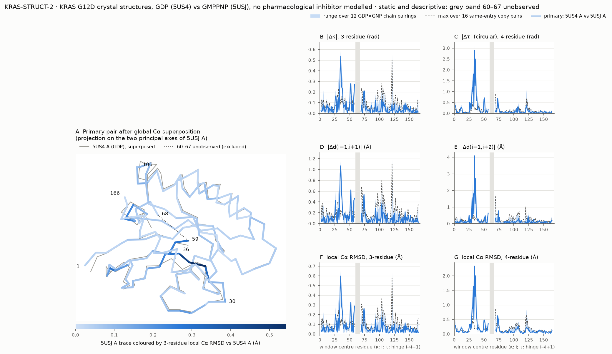

# KRAS-STRUCT-2: GDP- vs GMPPNP-bound KRAS G12D crystal structures (descriptive, static)

The second small experimental-structure comparison. It follows KRAS-STRUCT-1 (`../kras_struct_cmp/`). The question,
mapping, chain-selection policy, metrics and permitted interpretation were frozen in `run_spec.json`
(`results/KRAS-STRUCT-2_freeze.json`) before any comparison score was computed.

## Inputs

- **Entries:**
  - **5US4:** GDP, 1.83 Å, H 3, two chains.
  - **5USJ:** GMPPNP, 1.94 Å, P 1, six chains.
  - Both come from Welsch et al., *Cell* 168:878–889.e29 (2017), doi:10.1016/j.cell.2017.02.006.
- **Construct and mutation:** the same construct in both, His6-thrombin tag plus KRAS(1–169) with G12D. Apart from
  the tag, the sequence differs from wild-type 9O0N only at residue 12.
- **Ligands:**
  - Full non-polymer entity lists: 5US4 has GDP, Mg²⁺ and glycerol; 5USJ has GMPPNP and Mg²⁺.
  - **No pharmacological inhibitor is modelled in either entry.** The nucleotide and Mg²⁺ remain bound, so "ligand-free"
    and "apo" are not used.
  - Caveat from the paper's Methods: the GDP crystal grew in a drop containing 10 mM of a small-molecule compound and 4 %
    DMSO. The authors report no electron density for the compound.
- **Crystal conditions:** pH 9.1 with phosphate/PEG3350 (5US4) vs pH 5.5 with Bis-Tris/PEG3350 (5USJ).
- **Coordinate quality:**
  - No alternate locations in either entry.
  - Tyr32 side chain incomplete in 5USJ chains B and F; Cα is present.
  - Switch-II residues are unobserved: 60–64 in 5US4 A, 60–66 in 5US4 B, and 61–63 or 61–67 in 5USJ A or D.
- **Usage terms:** PDB data CC0. Local copies are git-ignored in `data_pdb/` (3.0 MB; SHA-256 in `run_spec.json`).

```bash
.venv/bin/python benchmarks/audit/kras_struct_g12d/run_kras2.py run      # frozen run (needs data_pdb/)
.venv/bin/python benchmarks/audit/kras_struct_g12d/plot_figure.py        # presentation-only redraw
```

## Design (frozen)

- **Mapping:**
  - Residues 1–59 and 68–166 (158 residues): those with an observed Cα in all eight chains, read from the deposition
    records.
  - The same residue set is used for every pairing.
  - Windows spanning 59→68 are excluded, with cause `numbering_discontinuity`: two three-residue and three
    four-residue windows.
- **Chain selection:**
  - Primary pair: 5US4 A vs 5USJ A, the first deposited chain of each entry.
  - Sensitivity: the other 11 GDP × GMPPNP chain pairings.
  - Context: the 16 same-entry copy pairs.
  - Crystal copies are not independent replicates, and no count across pairings is used as statistical evidence.
- **Metrics:** the same as KRAS-STRUCT-1, reused by import: |Δκ|, circular |Δτ|, |Δd(i−1, i+1)|, |Δd(i−1, i+2)|, and
  proper-rotation 3- and 4-residue Cα RMSD (MDAnalysis QCP). All are computed from the same adapter coordinates on the
  same windows.

## Results (from `results/KRAS-STRUCT-2_results.json` and `results/KRAS-STRUCT-2_table.csv`)



The figure is redrawn for legibility by `plot_figure.py` from the frozen table. The frozen run's own figure,
`results/KRAS-STRUCT-2_figure.png`, is kept; both show the same values.

**Global Cα RMSD (158 Cα, context only).**
- Primary pair: 0.974 Å; the 12 GDP × GMPPNP pairings range from 0.951 to 1.004 Å.
- Same-entry copy pairs: 0.053 Å (5US4 A–B) and 0.28–0.62 Å (5USJ pairs).

**Largest local differences (descriptive).** The clearest feature is a block of windows centred on residues 29–39:
- **Peak values in the primary pair (windows 33–36 and 34–36):**
  - |Δτ| 2.89 rad and 4-residue RMSD 2.33 Å at 33–36;
  - |Δd(i−1, i+2)| 4.08 Å at 33–36;
  - |Δκ| 0.54 rad and 3-residue RMSD 0.60 Å at 34–36.
- These windows rank among the ten largest in all 12 chain pairings for every metric.
- At 33–36, the smallest value over the 12 pairings (|Δτ| 2.89 rad, RMSD 2.20 Å) is far above the largest same-entry
  copy difference (0.27 rad, 0.19 Å).

**Smaller recurring windows:** 25–27, 50–53 and 57–59 (8–12 of 12 pairings, depending on the metric).

**Chain-dependent:**
- Windows 72–76 are among the ten largest in 2–11 of the 12 pairings, depending on the metric.
- In residues ~100–125 (for example 120–123), copy-to-copy differences within 5USJ exceed the primary GDP–GMPPNP
  differences. Local geometry there varies between crystallographic copies as much as between entries.

**Not assessable:** Switch II (60–67) is unobserved in at least one chain and is excluded.

**Equal-information agreement** (Spearman over windows; primary value, with the range over 12 pairings):

| Metric pair | Spearman |
|---|---|
| κ ~ 3-residue RMSD | 0.93 (0.88–0.96) |
| d(i−1, i+1) ~ 3-residue RMSD | 0.91 |
| κ ~ d(i−1, i+1) | 0.79 |
| τ ~ 4-residue RMSD | 0.82 (0.71–0.84) |
| d(i−1, i+2) ~ 4-residue RMSD | 0.61 |
| τ ~ d(i−1, i+2) | 0.38 (0.32–0.47) |

The pattern matches KRAS-STRUCT-1: the three-point metrics are close to redundant, and the four-point metrics agree
less.

## Comparison with KRAS-STRUCT-1 (descriptive)

Read from the frozen STRUCT-1 table (hash checked), on the windows present in both studies (154 three-residue and
152 four-residue windows). Values are from `cross_study_vs_struct1` in the results file.

**Recurs in both studies:**
- Windows centred around residues 30–38 are among the ten largest for every metric in both studies. Three to five of
  the ten largest windows per metric coincide.
- The three-point metrics are near-redundant in both studies, and the four-point metrics agree less.

**Differs between studies:**
- Whole-profile agreement between the two studies is modest: Spearman 0.28–0.63 per metric.
- Residues 102–110 rank high in STRUCT-1 but not in STRUCT-2.
  - STRUCT-1 has one chain per entry, so its chain dependence cannot be assessed.
  - In STRUCT-2, this region varies between crystallographic copies about as much as between entries.
- STRUCT-2 adds 50–53, 57–59 and the chain-dependent 72–76.
- Global RMSD (0.72 vs 0.97 Å) is not comparable: the residue sets differ (168 vs 158) and so do the crystal forms.

**Dependence on choices:**
- Alternate-conformation policy changed STRUCT-1 metrics by at most 0.10. STRUCT-2 has no alternate conformations.
- Chain choice does not move the 29–39 block in STRUCT-2. It does affect 72–76 and ~100–125.

**Not concluded:**
- Differences between the studies are not attributed to MRTX1133 or to G12D. Inhibitor presence, mutation, crystal
  form, pH and resolution all change together across the studies.
- The location of the recurring block in the Switch-I region is not independent biological validation: the region is
  known to differ between nucleotide states, and these are two crystal comparisons.
- No population, kinetic, functional-state or treatment-response claim is made.

## Costs

- **Downloads:** 3.0 MB of structures (PDB and mmCIF) plus about 1.2 MB of records and articles, including the
  closeout's paper checks.
- **CPU:** 83.4 CPU-s for the frozen run (36 s wall); about 5 CPU-s for the figure and verification.
