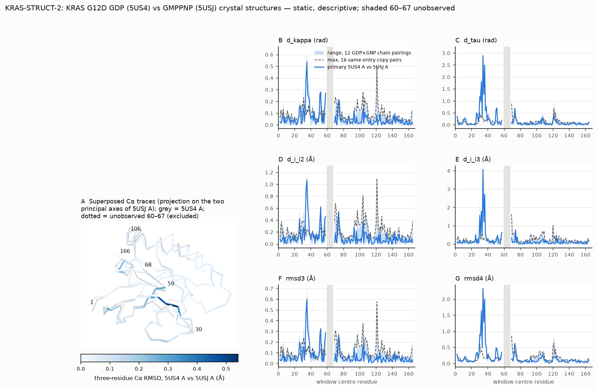

# KRAS-STRUCT-2: GDP-bound (5US4) vs GMPPNP-bound (5USJ) KRAS G12D, no pharmacological inhibitor modelled

Generated from `KRAS-STRUCT-2_results.json` and `KRAS-STRUCT-2_table.csv`. **Static structures: direct geometric differences only.** Confounded by crystal form (H 3, two copies vs P 1, six copies), crystallization pH and additives (9.1 with a compound present, no density reported, vs 5.5), resolution (1.83 vs 1.94 Å), unobserved Switch-II residues 60–67 (excluded) and coordinate error. Crystal copies are not independent replicates. No ensemble, population, kinetic, functional-state or treatment-response claim.

- Mapping: residues 1-59, 68-166 (158), identical in all 8 chains.
- Global Cα RMSD (QCP, 158 Cα): primary A-A 0.974 Å; 12 GDP×GNP pairings 0.951–1.004 Å; 16 same-entry copy pairs 0.053–0.620 Å.
- Excluded windows: three_residue: 58-68 (numbering_discontinuity 59->68), 59-69 (numbering_discontinuity 59->68); four_residue: 57-68 (numbering_discontinuity 59->68), 58-69 (numbering_discontinuity 59->68), 59-70 (numbering_discontinuity 59->68)

## Largest local differences, primary pair, and recurrence over the 12 chain pairings (descriptive)

| Metric | Unit | Ten largest primary windows (value; n/12 pairings with this window in their ten largest) |
|---|---|---|
| d_kappa | rad | 34-36 (0.537; 12/12), 33-35 (0.414; 12/12), 51-53 (0.281; 10/12), 57-59 (0.270; 12/12), 35-37 (0.266; 12/12), 50-52 (0.264; 10/12), 36-38 (0.238; 10/12), 37-39 (0.230; 11/12), 73-75 (0.212; 2/12), 74-76 (0.203; 4/12) |
| d_i_i2 | Å | 34-36 (1.067; 12/12), 33-35 (0.924; 12/12), 35-37 (0.651; 12/12), 51-53 (0.623; 12/12), 73-75 (0.539; 2/12), 57-59 (0.460; 9/12), 36-38 (0.460; 11/12), 56-58 (0.431; 4/12), 25-27 (0.426; 12/12), 72-74 (0.411; 2/12) |
| rmsd3 | Å | 34-36 (0.599; 12/12), 33-35 (0.484; 12/12), 51-53 (0.326; 10/12), 35-37 (0.323; 12/12), 57-59 (0.288; 11/12), 50-52 (0.271; 6/12), 36-38 (0.264; 9/12), 73-75 (0.263; 2/12), 37-39 (0.219; 10/12), 74-76 (0.212; 3/12) |
| d_tau | rad | 33-36 (2.894; 12/12), 35-38 (2.497; 12/12), 31-34 (1.812; 12/12), 34-37 (1.277; 12/12), 29-32 (1.182; 12/12), 30-33 (1.009; 12/12), 37-40 (0.772; 12/12), 50-53 (0.712; 10/12), 72-75 (0.696; 2/12), 49-52 (0.645; 2/12) |
| d_i_i3 | Å | 33-36 (4.082; 12/12), 35-38 (2.715; 12/12), 31-34 (1.802; 12/12), 29-32 (1.563; 12/12), 34-37 (1.208; 12/12), 73-76 (0.775; 11/12), 56-59 (0.637; 8/12), 32-35 (0.602; 10/12), 24-27 (0.516; 6/12), 36-39 (0.492; 6/12) |
| rmsd4 | Å | 33-36 (2.334; 12/12), 35-38 (2.004; 12/12), 31-34 (1.641; 12/12), 34-37 (1.289; 12/12), 29-32 (0.906; 12/12), 30-33 (0.870; 12/12), 72-75 (0.629; 2/12), 36-39 (0.606; 12/12), 37-40 (0.528; 10/12), 73-76 (0.490; 6/12) |

## Agreement between equal-information metrics (Spearman over windows; descriptive)

| Pair | Primary | Range over 12 pairings | Windows |
|---|---|---|---|
| d_kappa~d_i_i2 | 0.786 | 0.745–0.870 | 154 |
| d_kappa~rmsd3 | 0.931 | 0.879–0.961 | 154 |
| d_i_i2~rmsd3 | 0.908 | 0.885–0.941 | 154 |
| d_tau~d_i_i3 | 0.376 | 0.323–0.473 | 152 |
| d_tau~rmsd4 | 0.819 | 0.712–0.836 | 152 |
| d_i_i3~rmsd4 | 0.609 | 0.570–0.771 | 152 |

## Cross-study comparison with KRAS-STRUCT-1 (frozen table; descriptive)

Not attributable to inhibitor binding or G12D: these factors are not independently controlled across the studies, which also differ in crystal forms and conditions.

| Metric | Spearman (shared windows) | Overlapping ten-largest window centres | STRUCT-1 ten largest | STRUCT-2 ten largest |
|---|---|---|---|---|
| d_kappa | 0.352 (154) | [35, 36, 37, 38] | [29, 31, 32, 35, 36, 37, 38, 41, 104, 106] | [34, 35, 36, 37, 38, 51, 52, 58, 74, 75] |
| d_i_i2 | 0.348 (154) | [35, 36, 37] | [29, 31, 32, 35, 36, 37, 50, 104, 106, 107] | [26, 34, 35, 36, 37, 52, 57, 58, 73, 74] |
| rmsd3 | 0.383 (154) | [35, 36, 37] | [28, 29, 31, 32, 35, 36, 37, 41, 104, 106] | [34, 35, 36, 37, 38, 51, 52, 58, 74, 75] |
| d_tau | 0.489 (152) | [31, 32, 35, 36, 38] | [27, 29, 31, 32, 33, 35, 36, 37, 38, 108] | [30, 31, 32, 34, 35, 36, 38, 50, 51, 73] |
| d_i_i3 | 0.279 (152) | [30, 33, 34, 37] | [27, 28, 30, 31, 33, 34, 37, 103, 104, 108] | [25, 30, 32, 33, 34, 35, 36, 37, 57, 74] |
| rmsd4 | 0.634 (152) | [31, 36, 37] | [28, 29, 31, 33, 36, 37, 103, 104, 106, 108] | [30, 31, 32, 34, 35, 36, 37, 38, 73, 74] |

Resources: 83.4 CPU-s, 35.7 s wall.
