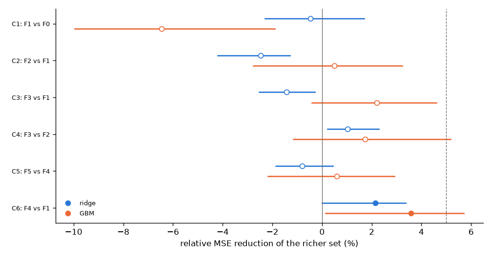
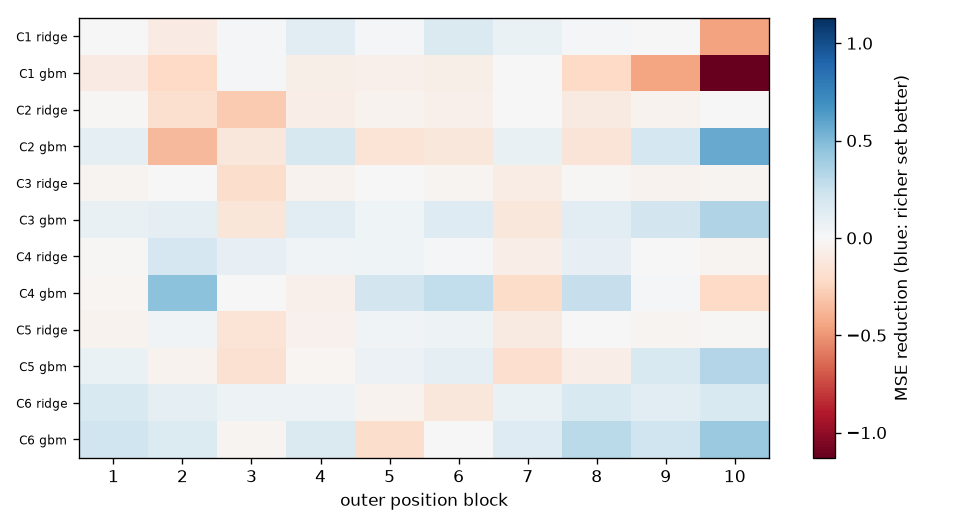

# MET exploratory evaluation: result (generated from `results/results.json`)

**Status: complete.** Internal, exploratory, descriptive. Target population: variants passing the measured no-drug eligibility rule; nothing here shows prediction for variants whose baseline function is unknown. Plan v2 and evaluator were frozen (commit 84215b8) before scoring; one scoring attempt. No commercial or redistribution rights are established; the source assay tables are not published.

Cells: 60 inhibitor × fold; non-ok cells: 0.

Rows used per inhibitor (eligible → used): Crizo 1986 → 1855 (structure-masked 128, mutation letter X 3, no ESM 0); Savo 1967 → 1520 (structure-masked 444, mutation letter X 3, no ESM 0); Mere 2036 → 1801 (structure-masked 232, mutation letter X 3, no ESM 0); A458 1950 → 1716 (structure-masked 231, mutation letter X 3, no ESM 0); Tepo 1997 → 1891 (structure-masked 103, mutation letter X 3, no ESM 0); NVP 1906 → 1540 (structure-masked 363, mutation letter X 3, no ESM 0).

## Predictive performance (position-weighted mean squared error of gamma; lower is better)

| feature set | model | MSE |
|---|---|---|
| F0 | ridge | 3.4751 |
| F0 | gbm | 3.5500 |
| F1 | ridge | 3.4914 |
| F1 | gbm | 3.7796 |
| F2 | ridge | 3.5778 |
| F2 | gbm | 3.7607 |
| F3 | ridge | 3.5410 |
| F3 | gbm | 3.6959 |
| F4 | ridge | 3.4163 |
| F4 | gbm | 3.6440 |
| F5 | ridge | 3.4439 |
| F5 | gbm | 3.6223 |

*Figure 1. Purpose: show every pre-declared paired comparison, not a selected one. Points: relative MSE reduction of the richer set over its reference (positive favours the richer set); bars: descriptive 95% moving-block-bootstrap interval (conditional on this dataset and procedure; coverage not assumed); dashed line: the provisional 5% engineering threshold; filled markers: the consistency criterion was met. Limitation: position blocks in sequence, one assay, six correlated inhibitors, wild-type-template features. Source: `results/results.json`.*

## Paired comparisons (identical rows and folds)

| id | test (a vs b) | model | Delta MSE | relative reduction | 95% interval (descriptive) | blocks improving | inhibitors improving | classification |
|---|---|---|---|---|---|---|---|---|
| C1 | F1 vs F0 | ridge | +0.0162 | -0.47% | [-0.0586, +0.0797] | 7/10 | 3/6 | criterion not met |
| C1 | F1 vs F0 | gbm | +0.2296 | -6.47% | [+0.0673, +0.3531] | 2/10 | 1/6 | criterion not met |
| C2 | F2 vs F1 | ridge | +0.0865 | -2.48% | [+0.0448, +0.1468] | 0/10 | 0/6 | criterion not met |
| C2 | F2 vs F1 | gbm | -0.0189 | +0.50% | [-0.1220, +0.1044] | 5/10 | 3/6 | criterion not met |
| C3 | F3 vs F1 | ridge | +0.0497 | -1.42% | [+0.0101, +0.0883] | 2/10 | 0/6 | criterion not met |
| C3 | F3 vs F1 | gbm | -0.0837 | +2.21% | [-0.1737, +0.0152] | 8/10 | 4/6 | inconclusive |
| C4 | F3 vs F2 | ridge | -0.0368 | +1.03% | [-0.0819, -0.0077] | 7/10 | 5/6 | inconclusive |
| C4 | F3 vs F2 | gbm | -0.0648 | +1.72% | [-0.1946, +0.0437] | 5/10 | 4/6 | criterion not met |
| C5 | F5 vs F4 | ridge | +0.0276 | -0.81% | [-0.0150, +0.0637] | 4/10 | 1/6 | criterion not met |
| C5 | F5 vs F4 | gbm | -0.0217 | +0.60% | [-0.1063, +0.0795] | 5/10 | 4/6 | criterion not met |
| C6 | F4 vs F1 | ridge | -0.0750 | +2.15% | [-0.1177, -0.0001] | 8/10 | 6/6 | criterion met |
| C6 | F4 vs F1 | gbm | -0.1355 | +3.59% | [-0.2156, -0.0055] | 8/10 | 6/6 | criterion met |

Family agreement: C1: criterion not met in either family (not-met or inconclusive); C2: criterion not met in either family (not-met or inconclusive); C3: criterion not met in either family (not-met or inconclusive); C4: criterion not met in either family (not-met or inconclusive); C5: criterion not met in either family (not-met or inconclusive); C6: criterion met in both families.

**Engineering outcome under the pre-declared rule (provisional 5% threshold; not demonstrated practical or commercial usefulness): do not continue geometric-feature development on this evidence (not equivalence; not proof of no effect).**

*Figure 2. Purpose: show consistency across the ten outer position blocks. Each cell is Delta MSE for one comparison and model family in one block (blue: the richer set is better, orange: worse; colour scale clipped symmetrically). Limitation: blocks are contiguous stretches of sequence with different numbers of eligible variants; a block-level sign is a coarse indicator. Source: `results/results.json`.*

## Sensitivity and context

Re-scoring the same out-of-fold predictions on rows whose approximate sd_gamma is at or below the median (0.570; rows kept {"Crizo": 745, "Savo": 586, "Mere": 661, "A458": 653, "Tepo": 693, "NVP": 544}): C1 ridge: criterion not met (relative -0.1%); C1 gbm: criterion not met (relative -3.9%); C2 ridge: criterion not met (relative -2.0%); C2 gbm: criterion not met (relative +0.2%); C3 ridge: criterion not met (relative -0.9%); C3 gbm: inconclusive (relative +1.2%); C4 ridge: inconclusive (relative +1.0%); C4 gbm: inconclusive (relative +1.1%); C5 ridge: criterion not met (relative -0.8%); C5 gbm: criterion not met (relative +0.0%); C6 ridge: criterion met (relative +3.0%); C6 gbm: criterion met (relative +3.8%). Engineering outcome on this subset: do not continue geometric-feature development on this evidence (not equivalence; not proof of no effect).

Noise context: mean approximate sd_gamma² = 0.327. sd_gamma^2 = sd_inh^2 + sd_DMSO^2 assumes zero covariance between the two estimates, which share controls; context only, not a measurement-error model and not a detectable-improvement bound.

Secondary per-inhibitor correlations of out-of-fold predictions with gamma (pooled rows; Spearman; these are not comparable with the authors' correlations, which concern a different endpoint and split):

| set model | Crizo | Savo | Mere | A458 | Tepo | NVP |
|---|---|---|---|---|---|---|
| F0 ridge | 0.03 | -0.07 | 0.03 | -0.08 | -0.02 | -0.04 |
| F0 gbm | 0.06 | -0.01 | 0.09 | -0.04 | 0.06 | 0.02 |
| F1 ridge | 0.07 | -0.09 | 0.07 | -0.13 | 0.13 | 0.07 |
| F1 gbm | 0.02 | -0.04 | -0.01 | -0.13 | 0.10 | 0.09 |
| F2 ridge | 0.02 | -0.11 | 0.01 | -0.14 | 0.06 | 0.07 |
| F2 gbm | 0.09 | -0.10 | 0.05 | -0.05 | 0.02 | 0.03 |
| F3 ridge | 0.04 | -0.04 | 0.04 | -0.16 | 0.09 | 0.07 |
| F3 gbm | 0.10 | -0.01 | 0.07 | 0.02 | 0.05 | 0.02 |
| F4 ridge | 0.16 | 0.00 | 0.18 | 0.03 | 0.16 | 0.11 |
| F4 gbm | 0.13 | 0.03 | 0.14 | -0.03 | 0.15 | 0.13 |
| F5 ridge | 0.14 | 0.04 | 0.15 | -0.02 | 0.14 | 0.13 |
| F5 gbm | 0.17 | 0.03 | 0.14 | 0.08 | 0.12 | 0.05 |

## Resources

CPU 88 s for the whole process and children (cap 1800 s), wall 88 s, peak resident memory 220 MB (cap 2048 MB), threads: bounded to 1 via environment before numpy import, child processes started: 0.

## Separation of claims

- **Predictive performance:** the MSE and correlation tables above, for this dataset, these features and this blocked procedure only.
- **Uncertainty:** the intervals and block/inhibitor counts are descriptive and conditional; shared controls and libraries make inhibitors dependent; sequence blocking does not remove spatial dependence.
- **Engineering continuation:** the pre-declared rule with the provisional 5% threshold, a prioritisation device only.
- **Commercial implications:** none are established by this evaluation. The authors report correlations between predicted and observed fitness scores. Our endpoint is gamma (inhibitor minus no-drug score) on no-drug-eligible variants, evaluated by position blocks with a buffer, per inhibitor, from wild-type-template features; theirs is a pooled model trained with predicted mutant-complex structure features and tested on held-out inhibitors, 20% of random positions and two amino acids. The endpoints and splits differ, so no numerical comparison or superiority ranking is made; the ESM arm (F4, F5) is the only external-model comparison, and their model was not recreated.
