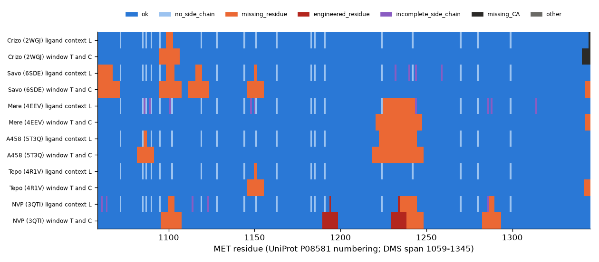

# MET wild-type template feature export (frozen exporter, generated from `results/manifest.json`)

**What it is:** a deterministic export of structural-site-context features for the MET kinase domain, from six experimental inhibitor complexes and the pinned UniProt P08581 sequence. **What it is not:** the features describe the wild-type template; they do not measure mutation-induced structural change. Masking an engineered template residue does not remove possible wider effects of that residue on the template. No assay table was read, no model trained.

- Contract: `CONTRACT.json`; exporter `met_export.py`; freeze `freeze_exporter.json` (committed before the first export; `run` refuses if frozen files differ). Row universe: 287 positions × 19 substitutions × 6 inhibitors = 32718 rows, generated from the reference sequence alone.
- Tables: `features_structure.csv` (1722 position×inhibitor rows; identical across the 19 substitutions by construction), `features_mutation.csv` (380 wild-type/substituted pairs), `coverage.csv`, `manifest.json`; `row_universe.csv` is regenerated and hash-checked (git-ignored). Join: `met_export.join_flat`.
- Blocks: mutation properties (volume, Kyte-Doolittle hydropathy, charge, BLOSUM62; pinned and cited), ligand/site context (4 columns), seven κ and six τ (sin, cos) from each nine-Cα window, all 36 pairwise Cα distances from exactly the same nine coordinates; explicit reason for every missing value.

| drug | PDB | chain | ligand (component, residue) | engineered residues | L ok | window ok (T and C) | altloc residues | incomplete side chains |
|---|---|---|---|---|---|---|---|---|
| Crizo | 2WGJ | A | VGH 2346 | none | 282/287 | 270/287 | 0 | 0 |
| Savo | 6SDE | A | V0L 1401 | none | 263/287 | 236/287 | 0 | 4 |
| Mere | 4EEV | A | L1X 1401 | none | 259/287 | 257/287 | 6 | 9 |
| A458 | 5T3Q | A | 75H 1401 | none | 263/287 | 247/287 | 0 | 0 |
| Tepo | 4R1V | A | 3E8 1401 | none | 285/287 | 273/287 | 8 | 0 |
| NVP | 3QTI | A | 3QT 1 | 1194 PHE, 1234 PHE | 263/287 | 236/287 | 0 | 5 |

*Figure 1. Purpose: show where each feature block is available, per inhibitor template, along the scanned span. Shows the primary reason per position (blue available, light blue glycine without side chain, orange missing residue, dark red engineered template residue, purple incomplete side chain, black missing Cα). Limitation: window masking propagates to every position whose nine-residue window contains an affected residue; unresolved loops differ by template, so missingness is not random. Source: `results/features_structure.csv`.*

Terms: PDB entries CC0 (wwPDB policy); UniProt sequence attributed (CC BY 4.0 per UniProt; its licence page was not re-read); literature scales cited; BLOSUM62 from NCBI. The exporter does not consume the assay tables, whose terms stay unresolved; no commercial data rights are inferred from any approval.

Reproduce: `.venv/bin/python benchmarks/audit/met_feature_export_2026-10-27/met_export.py run` (about 3 CPU-seconds), `make_coverage_figure.py`, `make_plan.py`, `make_readme.py`. The next evaluation is specified in `EVALUATION_PLAN.md`.
