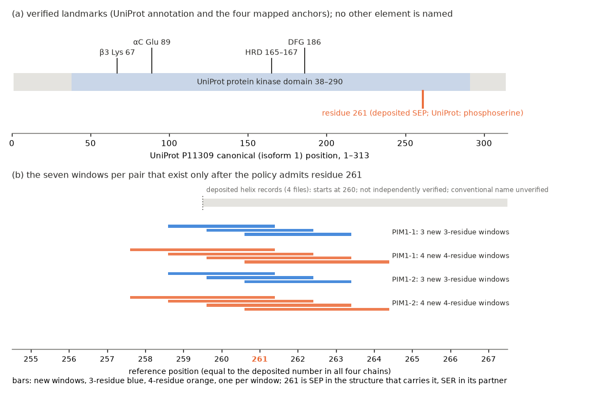

# Verified structural-role annotation of the existing PIM1 comparisons (generated report)

Generated by `make_report.py` from `results/pim1_annotation.json`. **Interpretation of existing outputs: no score was recomputed, no threshold changed, no structure selected; KIN-PAIR-1 and the phospho regression are unchanged.**
Reference: UniProt **P11309, P11309-1 (canonical), PIM1_HUMAN, 313 residues**, sequence SHA-256 `cbbfcc670c8d3cfe…`; FASTA hash equals the hash recorded in the KIN-PAIR-1 selection record.
Numbering convention: reference index = UniProt canonical position; author numbering is preserved, and its offset to the reference is **[0]** in all four chains (reported, never applied).
Annotation source: UniProt entry version 265 (annotation updated 2026-09-02), retrieved 2026-10-26T16:37:12+00:00, raw SHA-256 `40fdcd36a2a9a0d7…`. Rules were fixed in `DESIGN.md` before the run.

## Verification of the anchors (existing `kinase_roles` helper, defaults, role mutations refused)

| structure | pair slot | SHA-256 (first 12) | identity to the reference | differences from the reference (mutations) | modified residue names (helper) | author − reference offsets | helper accepted | ambiguity checks | anchors found |
|---|---|---|---|---|---|---|---|---|---|
| 8R0Q | PIM1-1:A | 6c9bd62287f5 | 0.9963 (267 aligned) | GLY 250 (reference R) | none | [0] | yes | 13, all unique: True | DFG_Asp 186DFG, beta3_Lys 67K, alphaC_Glu 89E, HRD_H 165HRD |
| 6NO9 | PIM1-1:B | 0115a741b19f | 1.0000 (273 aligned) | none | none | [0] | yes | 13, all unique: True | DFG_Asp 186DFG, beta3_Lys 67K, alphaC_Glu 89E, HRD_H 165HRD |
| 6VRV | PIM1-2:A | 5fb4eae4ba16 | 1.0000 (271 aligned) | none | none | [0] | yes | 13, all unique: True | DFG_Asp 186DFG, beta3_Lys 67K, alphaC_Glu 89E, HRD_H 165HRD |
| 6L17 | PIM1-2:B | 3ad04425727d | 1.0000 (273 aligned) | none | none | [0] | yes | 13, all unique: True | DFG_Asp 186DFG, beta3_Lys 67K, alphaC_Glu 89E, HRD_H 165HRD |

*Table 1. Purpose: show how the four structures map to the reference and that the helper's anchor and ambiguity checks passed. The αC Glu anchor (reference 89) was fixed by the pre-registered contact rule (the only Glu in 77–97 within 4.0 Å of the Lys 67 NZ in all four structures; the other Glu in the window, 79, does not qualify); the DFG anchor (186) by the unique DFG in the UniProt-bounded window 168–290.
Limitation: **successful anchor mapping verifies the four anchors, the ten derived roles and the ambiguity checks; it does not verify any helix or loop boundary**, and the αC rule is a coordinate contact rule, not an independent annotation. Source: `results/pim1_annotation.json`, `results/kinase_roles_reports.json`.*

| verified landmark | reference positions | source |
|---|---|---|
| UniProt protein kinase domain | 38–290 | UniProt P11309 feature (PROSITE PRU00159) |
| active site Asp (UniProt, proton acceptor); HRD Asp | 167 | UniProt active site; helper checks HRD at 165-167 |
| beta3 Lys (UniProt ATP binding site) | 67 | UniProt binding site; helper anchor |
| alpha-C Glu anchor | 89 | contact rule (4 structures) + helper motif check |
| DFG Asp anchor (motif DFG) | 186 | unique DFG in UniProt-bounded window; helper |

*Table 2. Purpose: the only landmarks used in the schematic and the text. Not established (kept "unverified"): activation loop extent; N-lobe/C-lobe boundary; conventional names of the helices after the DFG anchor; boundaries of every secondary-structure element beyond the deposited records; any functional role of residue 261 (UniProt lists it as a phosphoserine modified residue; the annotation is not evidence of a state here).*

## The seven new windows per pair, annotated by complete residue identifiers

| pair | window | residues (deposited number, structure A) | reference positions | inside UniProt kinase domain | deposited helix/strand in structure A / B | existing values (rad or Å) and rank among windows with values | SEP vs SER name difference flagged | in a top-10 of any metric |
|---|---|---|---|---|---|---|---|---|
| PIM1-1 | 3-res | 259 260 261 | 259–261 | yes | helix AB2; no deposited helix or strand / helix AB1; no deposited helix or strand | d_kappa 0.002 (rank 245/263); d_i_i2 0.016 (rank 208/263); rmsd3 0.008 (rank 224/263) | yes | no |
| PIM1-1 | 3-res | 260 261 262 | 260–262 | yes | helix AB2 / helix AB1 | d_kappa 0.008 (rank 200/263); d_i_i2 0.027 (rank 165/263); rmsd3 0.012 (rank 189/263) | yes | no |
| PIM1-1 | 3-res | 261 262 263 | 261–263 | yes | helix AB2 / helix AB1 | d_kappa 0.007 (rank 210/263); d_i_i2 0.002 (rank 260/263); rmsd3 0.010 (rank 209/263) | yes | no |
| PIM1-1 | 4-res | 258 259 260 261 | 258–261 | yes | helix AB2; no deposited helix or strand / helix AB1; no deposited helix or strand | d_tau 0.003 (rank 241/261); d_i_i3 0.007 (rank 235/261); rmsd4 0.012 (rank 255/261) | yes | no |
| PIM1-1 | 4-res | 259 260 261 262 | 259–262 | yes | helix AB2; no deposited helix or strand / helix AB1; no deposited helix or strand | d_tau 0.004 (rank 232/261); d_i_i3 0.045 (rank 144/261); rmsd4 0.018 (rank 240/261) | yes | no |
| PIM1-1 | 4-res | 260 261 262 263 | 260–263 | yes | helix AB2 / helix AB1 | d_tau 0.018 (rank 164/261); d_i_i3 0.002 (rank 252/261); rmsd4 0.021 (rank 223/261) | yes | no |
| PIM1-1 | 4-res | 261 262 263 264 | 261–264 | yes | helix AB2 / helix AB1 | d_tau 0.020 (rank 155/261); d_i_i3 0.015 (rank 216/261); rmsd4 0.023 (rank 212/261) | yes | no |
| PIM1-2 | 3-res | 259 260 261 | 259–261 | yes | helix AB1; no deposited helix or strand / helix AB2; no deposited helix or strand | d_kappa 0.009 (rank 209/269); d_i_i2 0.024 (rank 199/269); rmsd3 0.014 (rank 248/269) | yes | no |
| PIM1-2 | 3-res | 260 261 262 | 260–262 | yes | helix AB1 / helix AB2 | d_kappa 0.025 (rank 103/269); d_i_i2 0.059 (rank 103/269); rmsd3 0.031 (rank 150/269) | yes | no |
| PIM1-2 | 3-res | 261 262 263 | 261–263 | yes | helix AB1 / helix AB2 | d_kappa 0.052 (rank 43/269); d_i_i2 0.119 (rank 39/269); rmsd3 0.062 (rank 42/269) | yes | no |
| PIM1-2 | 4-res | 258 259 260 261 | 258–261 | yes | helix AB1; no deposited helix or strand / helix AB2; no deposited helix or strand | d_tau 0.018 (rank 176/268); d_i_i3 0.010 (rank 247/268); rmsd4 0.018 (rank 267/268) | yes | no |
| PIM1-2 | 4-res | 259 260 261 262 | 259–262 | yes | helix AB1; no deposited helix or strand / helix AB2; no deposited helix or strand | d_tau 0.014 (rank 195/268); d_i_i3 0.039 (rank 155/268); rmsd4 0.030 (rank 242/268) | yes | no |
| PIM1-2 | 4-res | 260 261 262 263 | 260–263 | yes | helix AB1 / helix AB2 | d_tau 0.044 (rank 93/268); d_i_i3 0.022 (rank 205/268); rmsd4 0.063 (rank 85/268) | yes | no |
| PIM1-2 | 4-res | 261 262 263 264 | 261–264 | yes | helix AB1 / helix AB2 | d_tau 0.024 (rank 145/268); d_i_i3 0.058 (rank 110/268); rmsd4 0.072 (rank 66/268) | yes | no |

*Table 3. Purpose: location, existing values and ranks of the windows that exist only after residue 261 is admitted. Locations: all lie inside the UniProt-annotated kinase domain, C-terminal to the DFG anchor (reference 186); the deposited HELIX records of all four files place residue 261 in a helix beginning at residue 260 (deposited labels differ per file; the extents agree), so windows starting before 260 straddle the deposited helix boundary, which is deposited annotation and not independently verified. The conventional name of that helix is **unverified**. Ranks are among all windows with values of the same metric in the new run (descending, ties by position). Values are existing; none was recomputed. Source: same file.*

*Figure 1. Purpose: place the added windows in the sequence using verified landmarks only. (a) UniProt kinase domain and the four mapped anchors; residue 261 is marked (deposited SEP; the UniProt entry lists a phosphoserine modified residue there, a curated annotation that is not evidence of a state in these structures). (b) the new windows by reference position; the grey bar is the deposited helix record (start at 260, dotted: boundary not independently verified). Limitation: sequence positions and deposited records only; no region name beyond the landmarks; one chain per structure. Source: same file.*

## What this adds, descriptively

- The new windows sit in the C-terminal part of the kinase domain, in or at the N-terminal end of the deposited helix 260–271, about 75 residues after the DFG anchor; the mapped anchors do not say whether that helix has a conventional name or a role.
- Their existing values are small: the largest value among the new windows is PIM1-1 0.045, PIM1-2 0.119; the best rank of any new window among the windows of its metric is PIM1-1 d_i_i3 rank 144 of 261, PIM1-2 d_i_i2 rank 39 of 269; **no new window is in a top-10 of any metric** (confirmed).
- **Previously reported descriptive conclusions: unchanged.** The recorded rule (top-10 overlap with the baselines) gives the same class and overlap before and after adding the windows:

| pair | windows | recorded in KIN-PAIR-1 | rule re-applied to the old numeric record (reproduces) | rule applied to the new numeric record |
|---|---|---|---|---|
| PIM1-1 | 3-residue | redundant (O=9, n=260) | redundant (O=9) | redundant (O=9, n=263) |
| PIM1-1 | 4-residue | complementary (O=6, n=257) | complementary (O=6) | complementary (O=6, n=261) |
| PIM1-2 | 3-residue | redundant (O=10, n=266) | redundant (O=10) | redundant (O=10, n=269) |
| PIM1-2 | 4-residue | redundant (O=9, n=264) | redundant (O=9) | redundant (O=9, n=268) |

*Table 4. Purpose: check whether the added windows change the recorded descriptive classification (rule and numbers of KIN-PAIR-1, applied to existing values). Limitation: descriptive counts over non-independent pairs, not a test. The maximum trimmed-fit displacement and its location were not recomputed; the global RMSD changed only by the refit with one more position (phospho replay).*

**Kept separate.** The modification (SEP; MODRES; UniProt modified residue) is an annotation. These pairs differ in construct, ligand and crystal form (and 8R0Q has GLY at 250 where the reference has R), so they do not isolate phosphorylation, a ligand or a mutation, and nothing here supports a functional interpretation of residue 261.
