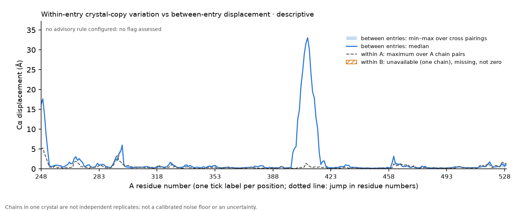

# structpair 0.3.0 on Abl: 1OPJ chains A, B versus 1OPK chain A (descriptive demonstration, 2026-10-25)

An exercise of the partial status of within-entry crystal-copy variation on a real pair. **Not an experiment, and nothing here can be
attributed to imatinib, nucleotide state, mutation or resistance.** 2F4J is not part of it.

From the deposited records (cross-checked with RCSB entry metadata; both entries are *Mus musculus* Abl1, UniProt P00520, not human): 1OPJ is a
kinase-domain construct (database residues 229–515) with imatinib, myristate and chloride, crystal form P 1, 2 chains, 1.75 Å; 1OPK is an
SH3–SH2–kinase construct (27–515) with PD166326, myristate and glycerol, an engineered D363N (PDB residue 382), crystal form C 2 2 21, 1 chain, 1.8 Å.
Neither contains a nucleotide. Missing residues (REMARK 465) inside the shared numbering: 1OPJ chain A 530–534, chain B 532–534; 1OPK chain A 532–534.

The correspondence rule was fixed before any comparison (see `run_demo.py`): PDB numbers 248–534, residues observed in all three chains,
a residue-name difference accepted only if SEQADV documents it as engineered. It gave 282 positions (248–529, no internal gap) and one flagged
name difference (residue 382). 1OPK's within-entry variation is unavailable (one chain) and is stored and drawn as missing, not zero. No advisory rule is configured, so
no flag is assessed.

| File | Content |
|---|---|
| `run_demo.py` | Input checks, the correspondence, the structpair run, the record and the caption |
| `specs/abl_1OPJ_AB_vs_1OPK_A.json` | The structpair spec |
| `results/abl_demo_record.json` | Inputs with SHA-256, header facts, RCSB cross-check, mapping, summary statistics, resources |
| `results/run/` | Compact outputs: `chain_variation.csv`, `chains.csv`, `chain_variation.png` (the figure), `chain_variation_caption.md`, `windows.csv`, `residues.csv`, `exclusions.csv`, `summary.json`, `manifest.json`, `report.md` |

Note on an earlier record: KIN-DESC-1's frozen `run_spec.json` lists construct differences against UniProt P00519 (human ABL1), while the deposited records name
P00520 (mouse). That record was not reopened; mouse–human differences in the kinase domain were not assessed here.

Resources: 14.5 CPU-s and 7.2 s wall; about 1.1 MB without `work/` (1.6 MB with it); the figure is 96 kB. Nothing was downloaded beyond RCSB entry metadata; nothing was sent externally.
