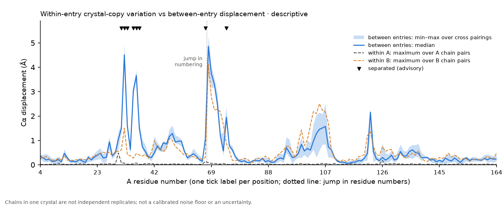

# STRUCTPAIR-CHAINS-VERIFY-1: multiple chains per entry, checked against earlier KRAS records

`python -m topofold_inputs.structpair` v0.2.0 (output corrected in v0.3.0, see below) accepts several explicitly named chains per entry and reports within-entry
crystal-copy variation (specification: `docs/STRUCTPAIR_CHAINS_SPEC_2026-10-25.md`; guide: `docs/STRUCTPAIR_USER_GUIDE.md` §3a).

> **Chains in one crystal are not independent experimental replicates**, and crystal packing can affect each of them. The
> within-entry crystal-copy variation is a descriptive range of differences among the chains the user selected: not a
> calibrated noise floor, not a statistical uncertainty, not a nucleotide or ligand effect and not an HDX replicate estimate.

**This is engineering verification of implementation consistency. It is not biological validation**, and the K1 gate result
(K1_ENDPOINT_INADEQUATE) is unchanged.

```bash
.venv/bin/python benchmarks/audit/structpair_chains_demo/verify_chains.py   # needs the git-ignored KRAS structures (structpair_demo/fetch_inputs.py)
```

| Check | Result (`results/verification.json`) |
|---|---|
| V1 the four committed single-chain demonstrations of v0.1.0, re-run | `windows.csv`, `residues.csv`, `exclusions.csv` byte-identical to the committed outputs in 4 of 4 runs; summary numbers equal |
| V2 KRAS-STRUCT-2 chains (5US4 A, B; 5USJ A–F): primary value, cross min/median/max over 12 pairings and within-entry maximum over 16 pairs, 6 metrics × 158 positions | 4,740 values compared against the frozen `KRAS-STRUCT-2_table.csv`: 0 mismatches, largest difference 0 (tolerance 1e-9) |
| V3 the exact K1 chains, residues (4–59, 68–164) and settings: displacement mean, median, primary pair, within-entry maxima, threshold and flag | 1,224 values compared against the frozen `KRAS-K1_endpoint.json`: 0 mismatches at the declared 1e-4 Å tolerance (largest difference 6.6e-6 Å); the flagged set equals the recorded K1 set (31–33, 35–37, 59, 74) |

The V3 tolerance is declared because the frozen K1 code parses the PDB text in float64 while the adapter holds float32
positions (up to 3.8e-6 Å from the text values); see the amendment in the specification.

**Resources** (6-core machine; `verification.json`): the 8-chain STRUCT-2 spec took 33.7 CPU-s and 19.9 s wall, the K1 spec 33.7 CPU-s
and 20.1 s; each wrote about 0.75 MB without `work/` and 1.7 MB with it. The four single-chain runs took 4–6 s each.

## Files

| Path | Content |
|---|---|
| `specs/kras2_all_chains_5US4_AB_vs_5USJ_AF.json`, `specs/k1_exact_chains_and_settings.json` | The two multi-chain specs |
| `verify_chains.py`, `results/verification.json` | The checks and their record |
| `results/k1_regression/` | The compact outputs of the K1 regression run, including `chain_variation.png` and its generated caption `chain_variation_caption.md` |



Nothing was sent externally; no outside human trial is claimed.

## Update 2026-10-25: advisory output corrected in v0.3.0 (schema /3)

The records in `results/` (`verification.json`, `k1_regression/`) were produced by 0.2.0 (schema /2, advisory/1) and are kept unchanged as
historical records. In them the `separated` column was true at 78 position-channel cells of the K1 regression, 70 of them on channels with no
configured floor. Version 0.3.0 reports the numbers and assesses the advisory flag only for a channel with a configured positive minimum
difference (see `docs/STRUCTPAIR_CHAINS_SPEC_2026-10-25.md`, amendment 2). `results/v0_3_0/` repeats the checks with 0.3.0: legacy demonstrations
4 of 4 byte-identical, STRUCT-2 4,740 values with 0 mismatches, K1 1,224 values with 0 mismatches at the declared 1e-4 Å tolerance,
flagged set equal to the recorded K1 set (8 displacement cells, K1's explicit 1 Å floor), K1 gate result unchanged. Evidence for the
correction: `../structpair_advisory_correction_2026-10-25/`.
