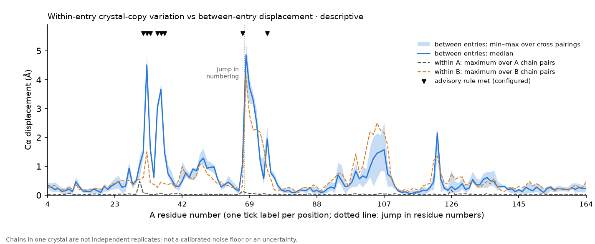

# Figure: within-entry crystal-copy variation, K1 regression run (structpair 0.3.0)

**Purpose.** To show what the new multi-chain output looks like on the chains and residues of the recorded K1 calculation, and
that it reproduces that calculation.

**What it shows.** Per residue (4–59 and 68–164), the Cα displacement between 5US4 (GDP) and 5USJ (GMPPNP) after a trimmed
fit: the min–max band and the median over the 12 chain pairings, and the maximum over the within-entry chain pairs of each
entry (dashed). Marks at the top are the residues for which the advisory rule, configured with the K1 settings (minimum difference 1 Å on the
displacement; the between-entry mean at least max(1 Å, 2 × the within-entry maximum)), is met. They are 8 residues (31, 32, 33, 35, 36, 37, 59, 74); the recorded K1 endpoint set is
identical. Across 1224 compared values the largest absolute
difference from the K1 record is 6.6e-06 Å (declared tolerance 0.0001 Å: the adapter holds
float32 positions, which differ from a float64 parse of the PDB text by up to 3.8e-06 Å).

**Main limitation.** Chains in one crystal are not independent experimental replicates, and crystal packing can affect each of
them. The dashed lines are descriptive ranges among the selected chains, not a calibrated noise floor, a statistical
uncertainty, a nucleotide effect or an HDX replicate estimate. Agreement with the K1 record shows implementation
consistency, not biological validity. The marks are an advisory rule the user configured, not significance and not biological
separation. The frozen K1 gate applied to the marked set gives its recorded result (identical; fails, K1_ENDPOINT_INADEQUATE unchanged).

**Source data.** `chain_variation.csv` and `manifest.json` in this directory (inputs 5US4 and 5USJ, SHA-256 in the manifest);
`benchmarks/audit/kras_k1/results/KRAS-K1_endpoint.json`.

**Reproduce.** `.venv/bin/python benchmarks/audit/structpair_chains_demo/verify_chains.py` (about 33 CPU-seconds for
this run; the figure is written by the command itself).
