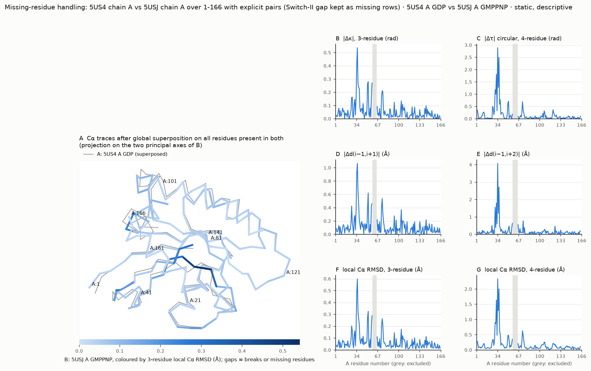

# Two-structure comparison: Missing-residue handling: 5US4 chain A vs 5USJ chain A over 1-166 with explicit pairs (Switch-II gap kept as missing rows)

**Descriptive, static.** Two static structures: the values are direct geometric differences between these coordinate sets. They can reflect crystal form and packing, crystallization conditions, resolution, refinement, alternate conformations and coordinate error as well as any biological difference. No ensemble, population, kinetic, functional-state or treatment-response claim follows. Agreement or disagreement between metrics does not show that one representation is better. Crystal copies of one entry are not independent replicates.

## Inputs

| | Label | File (SHA-256, first 12) | Chain | Altloc policy |
|---|---|---|---|---|
| A | 5US4 A GDP | `5US4.pdb` (a1d0c9105887) | A | reject |
| B | 5USJ A GMPPNP | `5USJ.pdb` (dab6b79531b0) | A | reject |

## Mapping

- Correspondence: pairs (166 positions; 161 present in both). Missing-residue policy: `exclude`.
- Residue-name mismatches (reject): none.
- Alternate locations resolved: none.
- Breaks (adapter): A [58, 59, 60, 61, 62, 63], B [59, 60, 61, 62] (row index after which the chain breaks).

## Global Cα RMSD (context only)

- 1.261 Å over 161 Cα after optimal superposition (MDAnalysis QCP); independent numpy SVD/Kabsch check 1.261 Å (|difference| 5.6e-14 Å).
- Published RMSD values often use other atom sets, residue ranges or outlier rejection; compare only with a stated definition.

## Largest local differences (top 10; descriptive)

| Metric | Unit | Windows (A numbering; value; * altloc, † residue-name mismatch in window) |
|---|---|---|
| d_kappa | rad | A:34..A:36 (0.537), A:33..A:35 (0.414), A:51..A:53 (0.281), A:57..A:59 (0.270), A:35..A:37 (0.266), A:50..A:52 (0.264), A:36..A:38 (0.238), A:37..A:39 (0.230), A:73..A:75 (0.212), A:74..A:76 (0.203) |
| d_i_i2 | Å | A:34..A:36 (1.067), A:33..A:35 (0.924), A:35..A:37 (0.651), A:51..A:53 (0.623), A:73..A:75 (0.539), A:57..A:59 (0.460), A:36..A:38 (0.460), A:56..A:58 (0.431), A:25..A:27 (0.426), A:72..A:74 (0.411) |
| rmsd3 | Å | A:34..A:36 (0.599), A:33..A:35 (0.484), A:51..A:53 (0.326), A:35..A:37 (0.323), A:57..A:59 (0.288), A:50..A:52 (0.271), A:36..A:38 (0.264), A:73..A:75 (0.263), A:37..A:39 (0.219), A:74..A:76 (0.212) |
| d_tau | rad | A:33..A:36 (2.894), A:35..A:38 (2.497), A:31..A:34 (1.812), A:34..A:37 (1.277), A:29..A:32 (1.182), A:30..A:33 (1.009), A:37..A:40 (0.772), A:50..A:53 (0.712), A:72..A:75 (0.696), A:49..A:52 (0.645) |
| d_i_i3 | Å | A:33..A:36 (4.082), A:35..A:38 (2.715), A:31..A:34 (1.802), A:29..A:32 (1.563), A:34..A:37 (1.208), A:73..A:76 (0.775), A:56..A:59 (0.637), A:32..A:35 (0.602), A:65..A:68 (0.558), A:24..A:27 (0.516) |
| rmsd4 | Å | A:33..A:36 (2.334), A:35..A:38 (2.004), A:31..A:34 (1.641), A:34..A:37 (1.289), A:29..A:32 (0.906), A:30..A:33 (0.870), A:72..A:75 (0.629), A:36..A:39 (0.606), A:37..A:40 (0.528), A:73..A:76 (0.490) |

## Agreement between equal-information metrics (Spearman over windows; descriptive)

| Pair | Spearman | Windows |
|---|---|---|
| d_kappa~d_i_i2 | 0.790 | 157 |
| d_kappa~rmsd3 | 0.932 | 157 |
| d_i_i2~rmsd3 | 0.910 | 157 |
| d_tau~d_i_i3 | 0.375 | 155 |
| d_tau~rmsd4 | 0.818 | 155 |
| d_i_i3~rmsd4 | 0.611 | 155 |

Three-residue metrics share one triangle, so close agreement is expected; d(i−1, i+2) is blind to the sign of τ.

## Exclusions

| Window (A) | Size | Structure | Cause | Location |
|---|---|---|---|---|
| A:58..A:60 | 3 | A | missing_CA | A:59→A:60 |
| A:59..A:61 | 3 | A | missing_coordinates | A:60 |
| A:59..A:61 | 3 | A | missing_coordinates | A:61 |
| A:59..A:61 | 3 | B | missing_CA | A:60→A:61 |
| A:60..A:62 | 3 | A | missing_coordinates | A:60 |
| A:60..A:62 | 3 | A | missing_coordinates | A:61 |
| A:60..A:62 | 3 | A | missing_coordinates | A:62 |
| A:60..A:62 | 3 | B | missing_coordinates | A:61 |
| A:60..A:62 | 3 | B | missing_coordinates | A:62 |
| A:61..A:63 | 3 | A | missing_coordinates | A:61 |
| A:61..A:63 | 3 | A | missing_coordinates | A:62 |
| A:61..A:63 | 3 | A | missing_coordinates | A:63 |
| A:61..A:63 | 3 | B | missing_coordinates | A:61 |
| A:61..A:63 | 3 | B | missing_coordinates | A:62 |
| A:61..A:63 | 3 | B | missing_coordinates | A:63 |
| A:62..A:64 | 3 | A | missing_coordinates | A:62 |
| A:62..A:64 | 3 | A | missing_coordinates | A:63 |
| A:62..A:64 | 3 | A | missing_coordinates | A:64 |
| A:62..A:64 | 3 | B | missing_coordinates | A:62 |
| A:62..A:64 | 3 | B | missing_coordinates | A:63 |
| A:63..A:65 | 3 | A | missing_coordinates | A:63 |
| A:63..A:65 | 3 | A | missing_coordinates | A:64 |
| A:63..A:65 | 3 | B | missing_CA | A:63→A:64 |
| A:64..A:66 | 3 | A | missing_CA | A:64→A:65 |
| A:57..A:60 | 4 | A | missing_coordinates | A:60 |
| A:58..A:61 | 4 | A | missing_coordinates | A:60 |
| A:58..A:61 | 4 | A | missing_coordinates | A:61 |
| A:58..A:61 | 4 | B | missing_coordinates | A:61 |
| A:59..A:62 | 4 | A | missing_coordinates | A:60 |
| A:59..A:62 | 4 | A | missing_coordinates | A:61 |
| A:59..A:62 | 4 | A | missing_coordinates | A:62 |
| A:59..A:62 | 4 | B | missing_coordinates | A:61 |
| A:59..A:62 | 4 | B | missing_coordinates | A:62 |
| A:60..A:63 | 4 | A | missing_coordinates | A:60 |
| A:60..A:63 | 4 | A | missing_coordinates | A:61 |
| A:60..A:63 | 4 | A | missing_coordinates | A:62 |
| A:60..A:63 | 4 | A | missing_coordinates | A:63 |
| A:60..A:63 | 4 | B | missing_coordinates | A:61 |
| A:60..A:63 | 4 | B | missing_coordinates | A:62 |
| A:60..A:63 | 4 | B | missing_coordinates | A:63 |
| A:61..A:64 | 4 | A | missing_coordinates | A:61 |
| A:61..A:64 | 4 | A | missing_coordinates | A:62 |
| A:61..A:64 | 4 | A | missing_coordinates | A:63 |
| A:61..A:64 | 4 | A | missing_coordinates | A:64 |
| A:61..A:64 | 4 | B | missing_coordinates | A:61 |
| A:61..A:64 | 4 | B | missing_coordinates | A:62 |
| A:61..A:64 | 4 | B | missing_coordinates | A:63 |
| A:62..A:65 | 4 | A | missing_coordinates | A:62 |
| A:62..A:65 | 4 | A | missing_coordinates | A:63 |
| A:62..A:65 | 4 | A | missing_coordinates | A:64 |
| A:62..A:65 | 4 | B | missing_coordinates | A:62 |
| A:62..A:65 | 4 | B | missing_coordinates | A:63 |
| A:63..A:66 | 4 | A | missing_coordinates | A:63 |
| A:63..A:66 | 4 | A | missing_coordinates | A:64 |
| A:63..A:66 | 4 | B | missing_coordinates | A:63 |
| A:64..A:67 | 4 | A | missing_coordinates | A:64 |

## Alternate-conformation sensitivity

Not requested.

## Figure

Files: `windows.csv` (all metrics with units in column names), `residues.csv`, `exclusions.csv`, `summary.json`, `manifest.json` (hashes and software). structpair 0.1.0.
